# CURSO COMPLETO

# MODULO 0

# Módulo 0: Diagnóstico y Nivelación (Preconceptos)

**Tiempo estimado**: 180 minutos  
**Nivel**: Básico (Ruta principal)  
**Fase**: Fase 0 — Nivelación de Entrada  
**Prerrequisitos**: Ninguno — Módulo base del curso

---

## 1. La Naturaleza del Dinero: Conceptos de Deuda y Valor

Para transformar tu relación con la riqueza, primero debes entender qué es realmente el dinero. La mayoría de las personas creen que el dinero es un objeto físico o un papel con valor intrínseco. Históricamente no es así. El dinero es, fundamentalmente, una **herramienta de contabilidad social** y una **representación de valor depositado**.

### De la Reserva de Valor al Dinero Fiduciario

En la antigüedad, las sociedades utilizaban el trueque o mercancías con valor intrínseco (oro, plata, sal) como medios de intercambio. Sin embargo, el dinero moderno es **dinero fiduciario** (del latín _fiducia_, que significa confianza). No está respaldado por oro ni plata; su valor reside únicamente en la confianza mutua de que el gobierno y la sociedad lo aceptarán como pago de bienes y servicios.

El dinero es un intermediario de la energía humana. Cuando trabajas, entregas tu tiempo y tu habilidad (energía) al mercado, y a cambio recibes dinero (un certificado de valor acumulado). Cuando compras algo, intercambias ese certificado por la energía de otra persona.

### La Relación con la Deuda: Esclavitud vs. Apalancamiento

En el sistema financiero moderno, el dinero nuevo se crea principalmente a través de la deuda (mediante el sistema de reserva fraccional bancario). La deuda tiene dos caras:

1. **Deuda de consumo (Esclavitud financiera)**: Pedir prestado para comprar pasivos (como vacaciones, ropa o un carro de lujo). Intercambias tu libertad y trabajo futuro para pagar intereses por algo que pierde valor de forma inmediata.
2. **Deuda productiva (Apalancamiento)**: Usar el dinero de otros (crédito) para adquirir activos que generen un retorno mayor que la tasa de interés de la deuda. Esto es lo que los millonarios denominan "deuda buena".

> [!NOTE]
> La regla de oro del dinero: El mercado no te paga por tu esfuerzo o por tu necesidad; te paga por el **valor percibido** que aportas en función de resolver problemas de otras personas.

---

## 2. Mentalidad: Abundancia vs. Escasez (Neurociencia de la Escasez)

La mentalidad no es una actitud mística; es una configuración biológica y neurológica de cómo tu cerebro procesa las amenazas y las oportunidades.

### La Neurociencia de la Escasez

Estudios liderados por el economista Sendhil Mullainathan y el psicólogo Eldar Shafir demuestran que experimentar escasez (ya sea de tiempo, dinero o atención) altera la capacidad cognitiva de manera mensurable. Este fenómeno se conoce como **"visión de túnel"**.

Cuando el cerebro percibe que no hay suficiente dinero para cubrir las necesidades inmediatas, activa la amígdala y el sistema de respuesta al estrés (cortisol e histamina). Esto produce:

- **Reducción del ancho de banda cognitivo**: Disminución temporal de hasta 13 puntos de coeficiente intelectual funcional.
- **Enfoque exclusivo a corto plazo**: Incapacidad neurológica de planificar a largo plazo porque la supervivencia inmediata consume toda la atención disponible.
- **Toma de decisiones impulsivas**: Decisiones financieras erróneas (como préstamos gota a gota o compras desesperadas) debido a la fatiga de decisión.

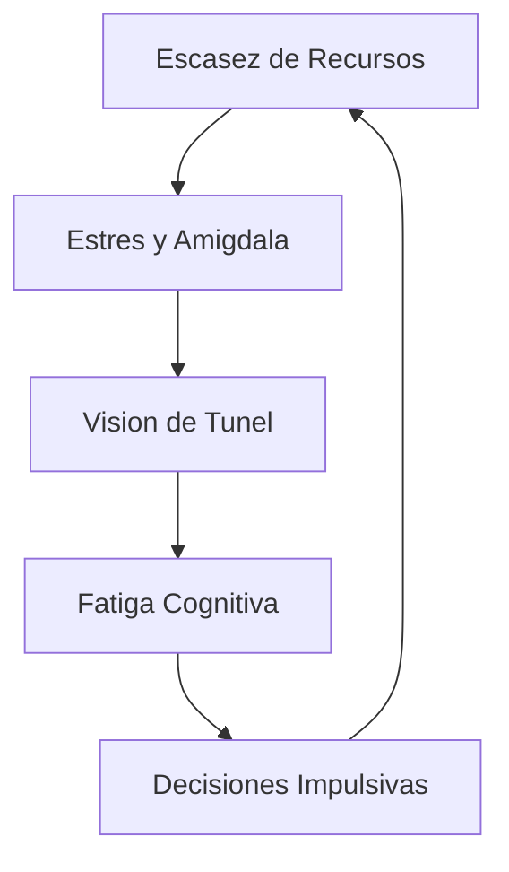

### La Mentalidad de Abundancia como Herramienta Pragmática

La abundancia no consiste en creer ingenuamente que todo es ilimitado. Es la habilidad cognitiva de desactivar la visión de túnel del estrés y enfocar el cerebro en la **creación de soluciones e identificación de oportunidades**.

Mientras que la escasez te hace competir por recursos limitados (un pastel pequeño), la abundancia te lleva a pensar en cómo hornear un pastel más grande mediante la colaboración y el desarrollo de nuevas habilidades.

---

## 3. Activos vs. Pasivos: El Balance Personal Simple

La definición tradicional de la contabilidad corporativa a menudo confunde a las personas en su economía personal. Por eso adoptamos la definición simplificada e hiper-operativa de Robert Kiyosaki:

- **Activo**: Todo aquello que **pone dinero en tu bolsillo**, trabajes o no.
- **Pasivo**: Todo aquello que **saca dinero de tu bolsillo** constantemente.

### La paradoja de la casa propia

Para la contabilidad de un banco, tu casa es un activo (para ellos, porque tú les pagas intereses). Pero para tu balance personal, la casa donde vives es un **pasivo** (genera gastos de hipoteca, impuestos, seguros, servicios y mantenimiento mensual). Solo se convierte en un activo si la alquilas a un tercero y el ingreso neto mensual supera todos los costos asociados.

| Activos Reales                                                    | Pasivos Frecuentes                                  |
| :---------------------------------------------------------------- | :-------------------------------------------------- |
| Negocios automatizados o franquicias                              | Préstamos de tarjetas de crédito                    |
| Propiedades de alquiler netas                                     | Automóvil de uso personal (crédito + mantenimiento) |
| Acciones, bonos o fondos indexados                                | Ropa de diseñador o tecnología de moda a crédito    |
| Activos intangibles (derechos de autor, patentes, cursos propios) | Suscripciones no utilizadas                         |

### El Flujo de Caja (Cashflow)

La riqueza no se mide por cuánto ganas, sino por la dirección de tu flujo de caja:

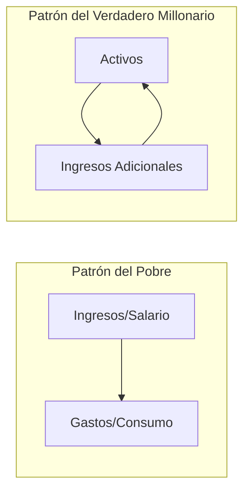

---

## 4. Interés Compuesto e Inflación: La Fórmula de la Bola de Nieve

El interés compuesto es la fuerza multiplicativa más poderosa de las finanzas. Ocurre cuando los intereses generados por una inversión se reinvierten para generar nuevos intereses en el siguiente período.

### La Matemática del Interés Compuesto

La fórmula matemática para calcular el valor futuro ($VF$) con interés compuesto es:

$$VF = VI \times (1 + r)^t$$

Donde:

- $VI$ = Valor Inicial (tu capital de partida).
- $r$ = Tasa de interés anual (expresada en decimal).
- $t$ = Tiempo en años que dejas correr la inversión.

#### El Efecto Bola de Nieve: Un ejemplo real

Imagina dos personas, Juan y María, que invierten $1,000 USD cada uno a una tasa del 10% anual de retorno estimado:

- **Juan** retira las ganancias cada año (Interés Simple): Después de 30 años, Juan habrá ganado $100 USD anuales ($3,000 USD en total), retirando al final sus $1,000 USD iniciales. Total acumulado: **$4,000 USD**.
- **María** reinvierte todas las ganancias (Interés Compuesto): Después de 30 años, sus $1,000 USD se habrán transformado en **$17,449.40 USD**. Las ganancias de los últimos años superan drásticamente a las de los primeros años.

El ingrediente crítico de esta ecuación no es la cantidad de dinero, sino el **tiempo ($t$)**.

### La Inflación: El Impuesto Silencioso

La inflación es el aumento generalizado y sostenido de los precios de los bienes y servicios, lo que equivale a la pérdida de poder adquisitivo del dinero. Si tu dinero rinde un 2% en una cuenta de ahorros tradicional pero la inflación anual es del 5%, estás perdiendo un 3% de tu riqueza real cada año. El dinero bajo el colchón no está seguro; se está evaporando lentamente.

---

## 5. Empleo vs. Emprendimiento: El Cuadrante Simplificado

Tu forma de generar ingresos determina tu relación con el tiempo y el potencial de tu riqueza. Adaptando el modelo de Robert Kiyosaki, dividimos el mercado en cuatro roles:

```
                  TIEMPO POR DINERO
            E (Empleado)    |    A (Autoempleo)
  --------------------------+--------------------------
            D (Dueño)       |    I (Inversionista)
                  SISTEMAS Y DINERO TRABAJANDO
```

1. **E (Empleado)**: Intercambias tiempo por un salario. Buscas seguridad, pero tus ingresos están limitados por las horas del día y la decisión de un tercero.
2. **A (Autoempleo)**: Eres tu propio jefe, pero si no trabajas, no hay ingresos (ej. médicos con consultorio, consultores independientes, freelance). Eres el engranaje principal de tu negocio.
3. **D (Dueño de negocio)**: Creas o controlas un sistema que funciona sin que estés físicamente allí. Empleas el tiempo de otros.
4. **I (Inversionista)**: Tu dinero trabaja para ti. Compras activos que generan más ingresos de forma pasiva.

Los verdaderos millonarios no se limitan a un solo cuadrante, sino que utilizan los ingresos de sus empleos o autoempleos para transicionar sistemáticamente hacia los cuadrantes **D** e **I**.


---

# Ejercicios Prácticos: Módulo 0 (Nivelación)

## Ejercicio 1: Diagnóstico de la Visión de Túnel (Evaluación del Sesgo de Escasez)

**Objetivo**: Identificar si tus decisiones financieras actuales están siendo influenciadas por el estrés de escasez (activación de la amígdala) o si se toman desde una perspectiva de largo plazo.

### Instrucciones

1. **Analiza** tus últimas 3 decisiones de compra no esenciales (aquellas que superen el 5% de tus ingresos mensuales disponibles).
2. **Completa** la siguiente tabla para cada decisión:

| Decisión de Compra               | ¿Qué problema inmediato resolvía?                  | ¿Qué impacto tiene a 1 año en tu balance?       | ¿Se decidió bajo presión o impulso? |
| :------------------------------- | :------------------------------------------------- | :---------------------------------------------- | :---------------------------------- |
| Ejemplo: Celular nuevo a crédito | "Sentirme al día con la tecnología/estatus social" | Pago de cuotas mensuales más intereses (Pasivo) | Sí, oferta de 'último día'          |
| 1.                               |                                                    |                                                 |                                     |
| 2.                               |                                                    |                                                 |                                     |
| 3.                               |                                                    |                                                 |                                     |

1. **Reflexión**: Si al menos una de tus decisiones se tomó para resolver un sentimiento de incomodidad inmediato sin considerar el impacto a 1 año, estás experimentando cierta medida de visión de túnel. Escribe una estrategia de 1 línea para prevenir esto en el futuro (ej. "esperar 24 horas antes de comprar").

---

## Ejercicio 2: El Inventario del Balance Personal Simple (Activos vs. Pasivos)

**Objetivo**: Estructurar un mapa claro y objetivo de tu situación financiera actual utilizando las definiciones simplificadas de Teach Laoz.

### Instrucciones

1. **Haz un inventario** honesto de tus pertenencias y obligaciones.
2. **Clasifícalas** en las siguientes columnas. Recuerda: una propiedad o carro que te cuesta dinero mensualmente va en la columna de Pasivos.

| Activos (Ponen dinero en tu bolsillo) | Flujo mensual neto ($) | Pasivos (Sacan dinero de tu bolsillo) | Costo mensual neto ($) |
| :------------------------------------ | :--------------------- | :------------------------------------ | :--------------------- |
| Ejemplo: Habitación alquilada         | +$150 pesos            | Ejemplo: Cuota del carro              | -$250 pesos            |
|                                       |                        |                                       |                        |
|                                       |                        |                                       |                        |
|                                       |                        |                                       |                        |
| **TOTAL FLUJO ACTIVOS:**              | **$****\_******        | **TOTAL COSTO PASIVOS:**              | **$****\_******        |

1. **Resultado**: Resta el Total de Costo de Pasivos del Total de Flujo de Activos.
    - Si el resultado es negativo: Tu balance está drenando tu energía futura. Tu prioridad inmediata en el curso será eliminar pasivos.
    - Si es positivo: Felicitaciones, tienes un flujo de caja positivo. Tu prioridad será adquirir más activos.

---

## Ejercicio 3: Simulación de la Bola de Nieve (Interés Compuesto vs. Inflación)

**Objetivo**: Visualizar y comprender la matemática detrás de la acumulación de riqueza y el efecto erosivo de la inflación.

### Instrucciones

Supongamos que decides apartar $100 pesos al mes para tu futuro. Tienes tres opciones para gestionar ese dinero:

1. **Opción A (Bajo el colchón)**: Ahorrar en efectivo. Tasa de rendimiento: 0% anual. Inflación estimada: 4% anual.
2. **Opción B (Cuenta de ahorros tradicional)**: Rendimiento: 2% anual. Inflación estimada: 4% anual.
3. **Opción C (Fondo de inversión indexado de bajo costo)**: Rendimiento histórico promedio: 8% anual. Inflación estimada: 4% anual.

Utiliza una calculadora de interés compuesto básica o realiza las estimaciones matemáticas para calcular el valor de tu dinero a los **10 años** en cada escenario:

- **Escenario A (Efectivo)**:
  - Dinero nominal total ahorrado: $12,000 pesos.
  - Valor real (ajustado por inflación al 4%): **~$9,800 pesos** (perdiste poder de compra).
- **Escenario B (Banco)**:
  - Dinero acumulado nominal: ~$13,270 pesos.
  - Valor real (ajustado por inflación del 4% - rendimiento real neto de -2%): **~$10,800 pesos**.
- **Escenario C (Inversión)**:
  - Dinero acumulado nominal: ~$18,290 pesos.
  - Valor real (ajustado por inflación del 4% - rendimiento real neto de +4%): **~$14,700 pesos**.

**Pregunta de Consolidación**: ¿Por qué ahorrar en una cuenta tradicional que paga menos que la inflación es equivalente a una pérdida lenta de tu capital? Escribe tu conclusión.


---

# Evaluación Diagnóstica: Módulo 0 (Nivelación)

**Nombre del estudiante:** ************\_\_\_************  
**Fecha:** ************\_\_\_************

---

## Preguntas de Opción Múltiple

### 1. El dinero fiduciario moderno se define principalmente como

- [ ] A) Un trozo de metal precioso respaldado por el banco central.
- [ ] B) Un certificado de confianza social que no posee valor intrínseco.
- [ ] C) Un recurso limitado controlado por la cantidad de oro de un país.
- [ ] D) Un pasivo que siempre genera rentabilidad positiva al poseedor.

### 2. Según los estudios de neurociencia sobre la escasez, la "visión de túnel" cognitiva produce

- [ ] A) Un aumento del enfoque en las metas a largo plazo y mejor planificación.
- [ ] B) Una reducción del ancho de banda cognitivo centrado en la supervivencia a corto plazo.
- [ ] C) Mayor claridad para tomar decisiones lógicas en situaciones de alto estrés.
- [ ] D) La desconexión permanente del sistema límbico y mayor optimismo.

### 3. Si compras un apartamento mediante crédito hipotecario para vivir en él con tu familia, para tu balance personal esto representa

- [ ] A) Un activo, porque aumentará su valor con los años en el mercado.
- [ ] B) Un pasivo, porque genera gastos mensuales de hipoteca, mantenimiento e impuestos.
- [ ] C) Una inversión libre de riesgo, porque elimina el costo de pagar arriendo.
- [ ] D) Un activo líquido, porque puedes venderlo en cualquier momento para obtener efectivo.

### 4. ¿Cuál es el factor más determinante para maximizar el efecto del interés compuesto en una inversión?

- [ ] A) La cantidad de capital inicial depositado en la cuenta.
- [ ] B) La entidad financiera donde se realiza la operación.
- [ ] C) El tiempo durante el cual se deja crecer la inversión de forma ininterrumpida.
- [ ] D) Las comisiones de corretaje que cobra la plataforma.

### 5. Si te desempeñas como consultor independiente cobrando tarifas por cada hora de asesoría que brindas a tus clientes, te encuentras en el cuadrante de

- [ ] A) E (Empleado)
- [ ] B) A (Autoempleo)
- [ ] C) D (Dueño de negocio)
- [ ] D) I (Inversionista)

---

## Sección de Respuestas Cortas

### 6. Explica la diferencia entre "ahorrar" e "invertir" a la luz del concepto de inflación

---

### 7. Describe un ejemplo de "deuda mala" (deuda de consumo) y uno de "deuda buena" (deuda de apalancamiento) aplicados a la vida cotidiana

---


---

# MODULO 1

# Módulo 1: La Mentalidad del Creador de Riqueza

**Tiempo estimado**: 420 minutos (7 horas)  
**Nivel**: Básico-Intermedio (Ruta principal)  
**Fase**: Fase 1 — Desconstrucción del Mindset Limitado  
**Prerrequisitos**: Módulo 0 completado

---

## 1. Tema 1.1: Reconfiguración de Creencias Limitantes

Tu relación con el dinero no se rige por leyes matemáticas o decisiones puramente racionales. Se rige por tus **creencias nucleares**, que a menudo son inconscientes y se formaron en tu infancia.

### Subtema 1.1.1: Patrones Heredados y el "Termostato Financiero"

El concepto de **"termostato financiero"** o "termostato económico" es una analogía psicológica muy útil. Un termostato está programado para mantener una habitación a una temperatura fija. Si hace mucho frío, enciende la calefacción; si hace mucho calor, enciende el aire acondicionado.

En tu mente existe un termostato equivalente que determina la cantidad de dinero con la que te sientes "cómodo" operando.

- **Si tus ingresos caen por debajo de tu termostato**: Te alarmas, buscas soluciones de emergencia, trabajas horas extra y regresas a tu zona de confort.
- **Si tus ingresos suben significativamente por encima de tu termostato**: De manera inconsciente, tu mente busca cómo "deshacerse" del excedente (mediante compras impulsivas, préstamos incobrables a familiares, o inversiones arriesgadas mal planificadas) para regresar a la temperatura emocional habitual.

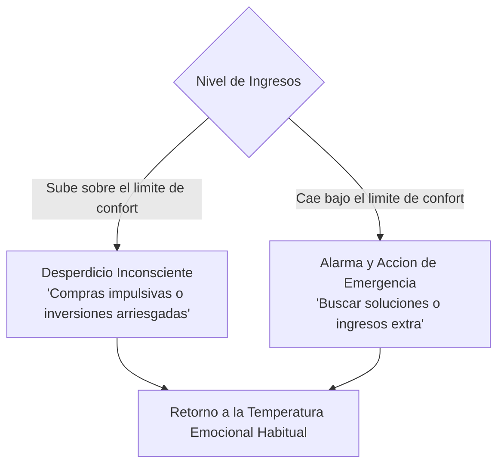

Este termostato se configura mediante el aprendizaje observacional en el núcleo familiar durante la infancia. Si escuchaste frases como "el dinero no crece en los árboles", "los ricos son malas personas" o "el dinero es sucio", tu cerebro grabó que el dinero es un recurso escaso y éticamente peligroso.

### Subtema 1.1.2: Reprogramación del Miedo a la Pérdida

El miedo a la pérdida es una respuesta evolutiva natural. Los seres humanos sufrimos de **aversión a la pérdida** (Kahneman y Tversky demostraron que el dolor de perder $100 pesos es emocionalmente el doble de intenso que el placer de ganar $100 pesos).

Para reprogramar este miedo, aplicamos el **reencuadre cognitivo**:

1. **Aceptar la incertidumbre como dato**: En el ámbito financiero, el riesgo cero no existe. Incluso el efectivo pierde valor por la inflación (como vimos en el Módulo 0).
2. **Definir el peor escenario posible (Fear Setting)**: Desglosar matemáticamente qué pasaría si pierdes una inversión atómica. Al ver que el peor escenario no significa la ruina absoluta sino una pérdida controlada de la que puedes recuperarte, la amígdala reduce su respuesta de pánico.

---

## 2. Tema 1.2: Responsabilidad Radical e "Internal Locus of Control"

La diferencia fundamental entre una persona con mentalidad de riqueza y una con mentalidad de pobreza no es el saldo de su cuenta bancaria, sino su explicación causal del mundo.

### Subtema 1.2.1: Pasar de Víctima a Protagonista

El psicólogo Julian Rotter definió el **Locus de Control** como el grado en que las personas creen que tienen el control sobre los eventos que afectan sus vidas:

- **Locus de Control Externo (Mentalidad de Víctima)**: Creer que la situación financiera depende de la suerte, el gobierno, la economía nacional, el jefe o el destino. Conduce a la indefensión aprendida.
- **Locus de Control Interno (Mentalidad de Protagonista)**: Creer que, aunque existen factores externos incontrolables, tus decisiones y acciones son la variable principal que determina tu futuro.

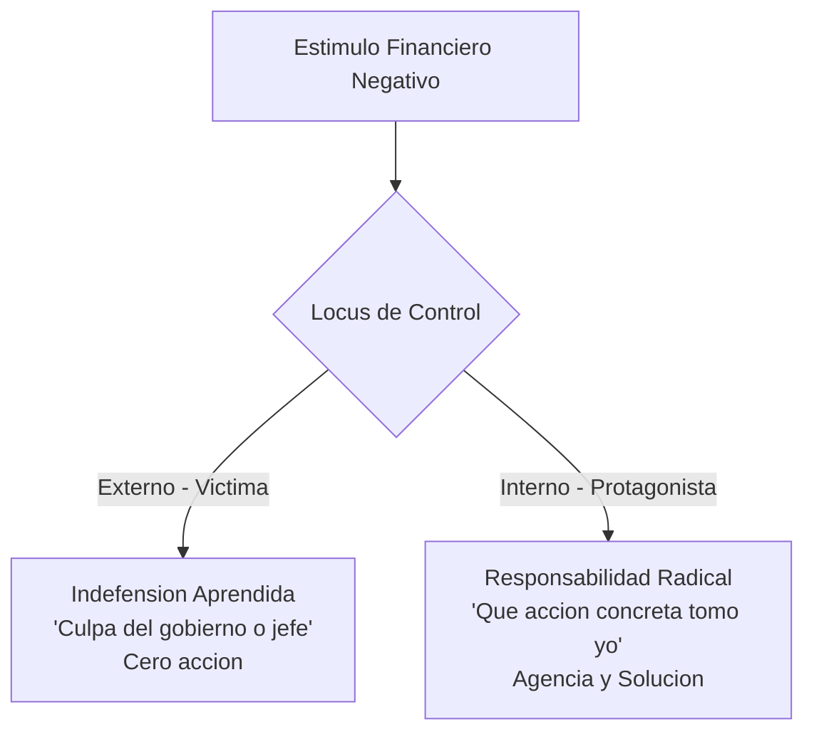

La **Responsabilidad Radical** consiste en asumir el 100% de la responsabilidad de tus reacciones y decisiones financieras cotidianas, sin importar cuán injusto sea el entorno.

### Subtema 1.2.2: El Hábito del "Ownership"

_Ownership_ significa adueñarse de los resultados. En finanzas personales, significa dejar de justificar los gastos innecesarios ("me lo merecía", "estaba en oferta") y comenzar a registrar de forma objetiva las consecuencias de cada decisión. Asumir el ownership te devuelve el poder de cambiar tu realidad, porque si el problema es tuyo, la solución también lo es.

---

## 3. Tema 1.3: Visión Sistémica del Éxito y "Delay of Gratification"

La riqueza sostenible es un subproducto de la arquitectura de tus decisiones en el tiempo.

### Subtema 1.3.1: Metas Antifrágiles y "Delay of Gratification"

El famoso **"experimento del malvavisco de Stanford"** (Walter Mischel, 1972) demostró que los niños capaces de retrasar la gratificación inmediata (esperar 15 minutos para recibir dos malvaviscos en lugar de comer uno de inmediato) tenían, décadas después, mejores niveles de salud, menores tasas de divorcio y una situación económica significativamente mejor.

La gratificación diferida es el pilar de la inversión. Invertir es, por definición, el acto de sacrificar consumo hoy para tener mayor capacidad de consumo y libertad mañana.

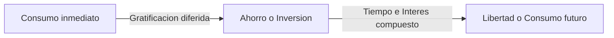

### Subtema 1.3.2: El Costo Cognitivo de las Decisiones Inmediatas

Cada decisión que tomas consume glucosa en tu corteza prefrontal, un recurso biológico limitado. Esto se conoce como **fatiga de decisión**.
Las personas bajo constante presión financiera (escasez) agotan rápidamente este recurso resolviendo emergencias cotidianas, lo que incrementa drásticamente la probabilidad de que tomen decisiones de compra impulsivas al final del día.

Para combatir esto, los millonarios automatizan sus decisiones financieras (automatización de transferencias de inversión) para no depender de la fuerza de voluntad diaria.


---

# Ejercicios Prácticos: Módulo 1 (Mentalidad)

## Ejercicio 1: Autoauditoría del Termostato Financiero

**Objetivo**: Detectar patrones de autosabotaje inconsciente y definir la temperatura actual de tu termostato financiero.

### Instrucciones

1. **Recuerda** un momento en tu vida en el que recibiste un ingreso extra inesperado (bono laboral, regalo, devolución de impuestos, etc.).
2. **Describe** qué hiciste con ese dinero en las 3 semanas posteriores a recibirlo. ¿Lo ahorraste/invertiste o encontraste "gastos de emergencia" o deseos repentinos para consumirlo?
3. **Identifica** 3 frases limitantes sobre el dinero que repetían tus padres o cuidadores en tu infancia.
    - _Frase 1:_ ****************************\_\_\_****************************
    - _Frase 2:_ ****************************\_\_\_****************************
    - _Frase 3:_ ****************************\_\_\_****************************
4. **Reencuadre**: Reescribe una de esas frases utilizando una perspectiva lógica y de abundancia (ej: de "el dinero corrompe a la gente" a "el dinero es una lupa que amplifica el carácter de quien lo posee; si soy buena persona, el dinero me permitirá hacer más bien").

---

## Ejercicio 2: El Reencuadre del Locus de Control (Víctima vs. Protagonista)

**Objetivo**: Reclamar el poder de acción sobre tus finanzas personales transformando explicaciones reactivas en proactivas.

### Instrucciones

1. **Lee** la siguiente lista de justificaciones típicas de una víctima.
2. **Reescribe** cada una bajo la perspectiva de un protagonista con locus de control interno y responsabilidad radical.

| Declaración de Víctima (Locus Externo)                                | Reencuadre de Protagonista (Locus Interno)                                                                                         |
| :-------------------------------------------------------------------- | :--------------------------------------------------------------------------------------------------------------------------------- |
| "No puedo ahorrar porque las cosas están muy caras por la inflación." | "La inflación reduce mi poder adquisitivo; por lo tanto, debo reducir gastos no esenciales u buscar una nueva fuente de ingresos." |
| "Mi trabajo paga muy poco y mi jefe no me valora."                    | "Mis ingresos actuales son bajos; debo adquirir una habilidad más valiosa para negociar un aumento o buscar otro empleo."          |
| "Perdí dinero en esa inversión porque me recomendaron mal."           | "Perdí dinero porque invertí en algo que no comprendía; asumo la responsabilidad y estudiaré mejor antes de arriesgar mi capital." |
| "Las tarjetas de crédito son una trampa de los bancos."               | "********************************\_\_********************************"                                                             |

---

## Ejercicio 3: Experimento de Gratificación Diferida (La Regla de las 24 Horas)

**Objetivo**: Entrenar la corteza prefrontal para resistir la fatiga de decisión y el impulso de consumo instantáneo.

### Instrucciones

1. **Identifica** un artículo de consumo no esencial que desees comprar en este momento (ropa, un gadget, comida de restaurante costosa, etc.).
2. **Aplica la regla de las 24 horas**: Comprométete a no realizar la compra durante las próximas 24 horas. Guarda el artículo en tu carrito de compras digital o anota el deseo en una libreta.
3. **Audita tu estado emocional** al día siguiente respondiendo:
    - ¿Sigues sintiendo la misma urgencia de comprarlo?
    - Si decides no comprarlo, ¿en qué activo útil podrías destinar ese dinero?


---

# Evaluación: Módulo 1 (Mentalidad)

**Nombre del estudiante:** ************\_\_\_************  
**Fecha:** ************\_\_\_************

---

## Preguntas de Desarrollo y Análisis

### 1. ¿Qué es el "termostato financiero" y cómo se manifiesta el autosabotaje cuando una persona supera temporalmente su nivel de confort económico?

---

### 2. Julian Rotter definió el "Locus de Control". Explica la diferencia entre un Locus de Control Interno y uno Externo aplicado a la gestión de deudas personales:

---

### 3. En el experimento del malvavisco de Stanford sobre la gratificación diferida (delay of gratification), ¿cuál es el principio psicológico subyacente que permite a una persona construir riqueza a largo plazo y cómo se relaciona con la inversión?

---

### 4. ¿Qué es la "fatiga de decisión" y por qué las personas con estrés financiero constante tienen mayor probabilidad de tomar decisiones de gasto impulsivas e ineficientes al final del día?

---

---

## Ejercicio de Situación Real

### 5. Imagina que tu coche sufre una avería mecánica que te costará $500 pesos reparar de forma imprevista. Redacta dos respuestas a esta situación: una desde el rol de "Víctima" (Locus Externo) y otra desde el rol de "Protagonista" (Locus Interno con Responsabilidad Radical).

- **Respuesta de Víctima (Locus Externo):**
  ***
- **Respuesta de Protagonista (Locus Interno):**
  ***


---

# MODULO 2

# Módulo 2: Arquitectura del Tiempo y Costo de Oportunidad

**Tiempo estimado**: 420 minutos (7 horas)  
**Nivel**: Intermedio (Ruta principal)  
**Fase**: Fase 2 — Optimización de Activos Intangibles  
**Prerrequisitos**: Módulos 0 y 1 completados

---

## 1. Tema 2.1: El Tiempo como Activo Finito

El dinero se puede perder y recuperar, se puede imprimir y se puede pedir prestado. El tiempo no. El tiempo es el único activo verdaderamente no renovable y democrático del ser humano (todos disponemos de 24 horas al día). Los verdaderos millonarios no valoran el dinero por encima de todo; valoran el dinero porque les permite comprar libertad de tiempo.

### Subtema 2.1.1: Cálculo de la Tasa Real por Hora

La mayoría de las personas calculan el valor de su tiempo de forma simplista: dividiendo su salario mensual por las horas que pasan en la oficina. Esto es un error financiero básico.
Para calcular tu **Tasa Real por Hora (TRH)**, debes aplicar la siguiente fórmula sistémica:

$$TRH = \frac{Ingresos\ Netos - Costos\ de\ Trabajo}{Horas\ de\ Trabajo + Horas\ de\ Transporte + Horas\ de\ Preparación}$$

- **Costos de Trabajo**: Transporte, almuerzos fuera de casa, ropa formal requerida, impuestos, comisiones, cuidado de niños extra, etc.
- **Horas de Transporte e Insumo**: El tiempo que pasas en el tráfico de ida y vuelta a la oficina, el tiempo que pasas en casa respondiendo correos pendientes o preparándote para el trabajo.

#### Caso Práctico

- **Cálculo tradicional**: Ganas $2,000 pesos netos al mes por 160 horas de oficina. Crees que tu tiempo vale **$12.50 pesos por hora**.
- **Cálculo real (TRH)**: Gastas $300 pesos al mes en transporte y comida fuera de casa. Además de las 160 horas de oficina, gastas 40 horas al mes en transporte y 10 horas respondiendo correos desde casa los fines de semana.
  - Ingresos reales netos: $1,700 pesos.
  - Horas reales invertidas: 210 horas.
  - Tasa Real por Hora: **$8.09 pesos por hora**.

Calcular tu TRH te permite tomar decisiones de compra más inteligentes. Si quieres comprar unos zapatos de $80 pesos, no pienses en el precio; piensa: _¿Vale la pena entregar 10 horas de mi vida real a cambio de estos zapatos?_

### Subtema 2.1.2: Apalancamiento del Tiempo de Otros (OPT)

Para escapar del cuadrante de Empleado o Autoempleado, debes aprender a **apalancarte**. Los millonarios compran el tiempo de otras personas para liberar el suyo propio y enfocarlo en tareas de alta rentabilidad (como crear sistemas o evaluar inversiones).

- **Si tú limpias tu casa** (costo de oportunidad: tu TRH es $30/h y contratar a alguien cuesta $10/h), estás perdiendo $20/h de valor neto potencial.
- **Delegar no es un gasto**: Es una compra estratégica de tiempo para enfocar tu energía en actividades que generen mayor retorno.

---

## 2. Tema 2.2: Interés Compuesto del Conocimiento (Efecto Snowball)

Al igual que el dinero, el conocimiento acumulado de forma sistemática y deliberada crece exponencialmente gracias al interés compuesto.

### Subtema 2.2.1: Curvas de Aprendizaje y Hábitos Atómicos

Según James Clear en su libro _Atomic Habits_, si logras mejorar una habilidad apenas un **1% cada día**, al cabo de un año serás **37 veces mejor** en esa habilidad.

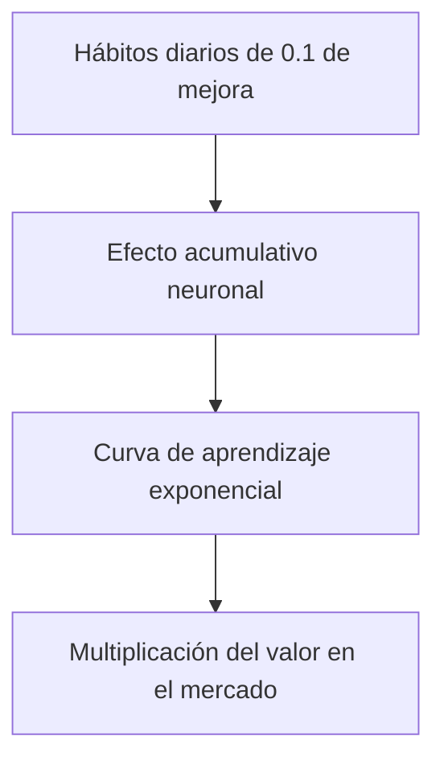

La constancia en el estudio y la lectura de libros técnicos o científicos de tu área de especialización actúa como una bola de nieve de conocimiento que el mercado terminará pagando muy bien.

### Subtema 2.2.2: "Skill Stacking" (Apilamiento de Habilidades)

No necesitas ser el mejor del mundo en una sola habilidad (lo cual es extremadamente difícil y costoso). El camino más viable hacia la riqueza es el **Skill Stacking**: convertirte en alguien en el top 20% en 3 o 4 habilidades complementarias.

- _Ejemplo_: Si eres un programador promedio (top 50%), tus ingresos serán estándar. Pero si sumas habilidades de oratoria y ventas (top 20%) y diseño de interfaces de usuario (top 20%), te transformas en un profesional sumamente escaso y valioso, capaz de crear y vender sus propios sistemas.

---

## 3. Tema 2.3: Análisis de Costo de Oportunidad

Cada vez que dices "Sí" a algo, le estás diciendo automáticamente "No" a infinitas alternativas. El costo de oportunidad es el valor de la mejor opción que decides descartar al tomar una decisión.

### Subtema 2.3.1: Decisiones Bajo Incertidumbre

Al evaluar un proyecto o inversión, no debes medir únicamente el beneficio esperado; debes compararlo contra la rentabilidad de dejar tu dinero o tu tiempo en la opción alternativa más segura (como un fondo indexado o tu trabajo principal).
Si un nuevo negocio te da a ganar $500 pesos al mes pero te cuesta 30 horas de trabajo semanales, y en tu empleo actual ganarías $800 pesos por esas mismas 30 horas, el negocio tiene un costo de oportunidad negativo.

### Subtema 2.3.2: El Costo Invisible de la Procrastinación Productiva

La **procrastinación productiva** es una trampa cognitiva muy sutil. Consiste en pasar horas haciendo tareas de bajo valor (como organizar archivos, responder correos sin importancia, o tomar cursos introductorios que no aplicas) para evitar realizar la tarea verdaderamente difícil pero de alto impacto (como hacer una llamada de ventas o lanzar tu MVP).
Creemos que estamos trabajando, pero en realidad estamos gastando nuestro activo más escaso (el tiempo) con un costo de oportunidad inmenso.


---

# Ejercicios Prácticos: Módulo 2 (Arquitectura del Tiempo)

## Ejercicio 1: Auditoría y Cálculo de tu Tasa Real por Hora (TRH)

**Objetivo**: Conocer el valor real y objetivo de cada hora de tu vida laboral para guiar decisiones de delegación y consumo.

### Instrucciones

1. **Completa** los siguientes datos basados en tu último mes laboral completo.
2. **Calcula** los resultados utilizando las fórmulas explicadas en el contenido.

#### Datos de Entrada

- (A) Ingresos mensuales netos (después de impuestos): $****\_\_\_**** pesos
- (B) Costo de transporte mensual al trabajo: $****\_\_\_**** pesos
- (C) Costo de almuerzos o cafés fuera por trabajo: $****\_\_\_**** pesos
- (D) Otros costos de trabajo (ropa, cuidado extra, etc.): $****\_\_\_**** pesos
- (E) Horas de oficina reales al mes: ****\_\_\_**** horas
- (F) Horas mensuales de transporte al trabajo: ****\_\_\_**** horas
- (G) Horas extras no remuneradas en casa: ****\_\_\_**** horas

#### Operaciones

- (H) Ingresos Netos Reales = (A) - (B) - (C) - (D) = $****\_\_\_**** pesos
- (I) Horas Totales Reales Invertidas = (E) + (F) + (G) = ****\_\_\_**** horas

$$\mathbf{Tasa\ Real\ por\ Hora\ (TRH)} = \frac{(H)}{(I)} = \mathbf{\$\_\_\_\_\_\_\_\_\_\_ pesos/hora}$$

1. **Reflexión**: Si deseas adquirir un producto o servicio que cuesta $150 pesos, ¿cuántas horas reales de trabajo de tu vida representa (Costo / TRH)? Anota tu reflexión sobre si sigues considerando viable esa compra.

---

## Ejercicio 2: Diseño de tu Mapa de Skill Stacking (Apilamiento de Habilidades)

**Objetivo**: Planificar la adquisición de habilidades complementarias para multiplicar tu valor y no depender de ser el número uno absoluto.

### Instrucciones

1. **Identifica** tu habilidad principal actual (en la que tienes experiencia o formación).
2. **Elige** 2 habilidades complementarias que, al fusionarse con tu habilidad principal, creen un perfil profesional escaso y de alto valor en el mercado.
3. **Completa** tu mapa de apilamiento:

```
  +---------------------------------------------+
  | Habilidad Principal:                        |
  | (ej: Programador de bases de datos)         |
  +----------------------+----------------------+
                         |
      +------------------+------------------+
      |                                     |
+-----+----------------------+       +------+----------------------+
| Habilidad Complementaria 1:|       | Habilidad Complementaria 2:|
| (ej: Ventas y Oratoria)    |       | (ej: Gestión de Proyectos)  |
+----------------------------+       +-----------------------------+
```

1. **Plan de Acción**: Define un hábito diario de 15 minutos para comenzar a construir una de las habilidades complementarias elegidas durante este mes (ej: leer 5 páginas de un libro de ventas al día).

---

## Ejercicio 3: Auditoría del Costo de Oportunidad de la Procrastinación

**Objetivo**: Visibilizar el impacto económico y temporal de la procrastinación productiva en tus proyectos.

### Instrucciones

1. **Identifica** un proyecto de generación de valor o estudio que desees lanzar (ej: escribir un ebook, diseñar un sitio web, estudiar programación).
2. **Anota** 3 actividades de "procrastinación productiva" que utilizas para evitar la tarea clave y difícil de ese proyecto:
    - _Actividad 1:_ ****************************\_\_\_**************************** (ej: organizar el escritorio)
    - _Actividad 2:_ ****************************\_\_\_**************************** (ej: leer más tutoriales repetidos)
    - _Actividad 3:_ ****************************\_\_\_****************************
3. **Calcula el Costo de Oportunidad**: Si dedicas 5 horas a la semana a estas actividades de bajo valor en lugar de la tarea clave de tu proyecto, y asumiendo tu TRH del Ejercicio 1, ¿cuánto dinero estás perdiendo indirectamente al mes?
    - Costo de Oportunidad Mensual = (5 horas × 4 semanas) × TRH = **$****\_\_\_**** pesos**.


---

# Evaluación: Módulo 2 (Arquitectura del Tiempo)

**Nombre del estudiante:** ************\_\_\_************  
**Fecha:** ************\_\_\_************

---

## Preguntas de Análisis y Aplicación

### 1. ¿Por qué el cálculo tradicional del valor por hora (Salario / Horas de Oficina) es impreciso desde una perspectiva financiera y qué variables incluye la Tasa Real por Hora (TRH)?

---

### 2. Explica el concepto de "Apalancamiento de Tiempo de Otros" (OPT) y describe cómo un autoempleado puede transicionar a dueño de negocio mediante este principio

---

### 3. ¿Qué es el "Skill Stacking" y por qué se considera una estrategia con mayor probabilidad de éxito para la generación de ingresos altos que el intentar ser el número uno en una sola especialidad?

---

### 4. Define "Costo de Oportunidad". Describe una situación cotidiana donde un ahorro de dinero (ej. reparar tu propia lavadora sin saber del tema) pueda tener un costo de oportunidad negativo

---

---

## Caso Práctico de Toma de Decisiones

### 5. Tienes un empleo de tiempo completo que te paga $15 pesos netos por hora real. Quieres iniciar un negocio digital que te tomará 20 horas a la semana. Durante los primeros 6 meses, estimas que el negocio generará pérdidas de $100 pesos al mes. A partir del mes 7, proyectas que ganará $200 pesos al mes

Analiza este escenario utilizando el concepto de Costo de Oportunidad y responde: ¿cuál es el costo real del proyecto en los primeros 6 meses, considerando el tiempo que dejas de facturar en tu empleo, y qué variables no monetarias deberías evaluar para saber si es una decisión financieramente viable a largo plazo?

---

---

---

---


---

# MODULO 3

# Módulo 3: Finanzas Prácticas e Ingeniería de Hábitos de Riqueza

**Tiempo estimado**: 480 minutos (8 horas)  
**Nivel**: Intermedio (Ruta principal)  
**Fase**: Fase 3 — Estructuración de Sistemas de Acumulación  
**Prerrequisitos**: Módulos 0, 1 y 2 completados

---

## 1. Tema 3.1: Págate a ti Mismo Primero (Presupuesto Inverso)

La mayoría de las personas gestionan sus finanzas personales utilizando una fórmula destinada al fracaso:

$$\text{Ahorro} = \text{Ingresos} - \text{Gastos}$$

En este esquema, el ahorro es un residuo. Se ahorra lo que sobra al final del mes. Dado que el cerebro humano tiende a adaptar el nivel de consumo al dinero disponible (esto se llama **Ley de Parkinson**: "los gastos aumentan hasta cubrir los ingresos"), al final del mes el residuo suele ser cero.

Los verdaderos millonarios utilizan la fórmula del **Presupuesto Inverso**:

$$\text{Dinero disponible para gastar} = \text{Ingresos} - \text{Inversión/Ahorro Automatizado}$$

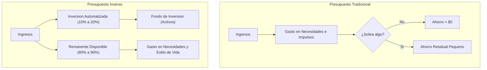

### Subtema 3.1.1: Automatización del Ahorro e Inversión

La fuerza de voluntad es un recurso limitado y poco fiable. No confíes en tu fuerza de voluntad para ahorrar. La clave está en la **automatización**:

1. Define un porcentaje inicial realista (mínimo el 10% de tus ingresos netos).
2. Configura transferencias automáticas en la aplicación de tu banco para que, el mismo día que recibes tu salario o ingresos, ese 10% sea transferido inmediatamente a una cuenta de inversión separada (por ejemplo, a una cuenta de corretaje o un fondo indexado).
3. Aprende a vivir y ajustar tus gastos al 90% restante. Al no ver ese dinero en tu cuenta corriente habitual, tu cerebro lo asume como inexistente y adapta el estilo de vida de forma natural.

### Subtema 3.1.2: Eliminación Sistemática de Gastos Hormiga

Los **gastos hormiga** son pequeños consumos diarios que parecen insignificantes de forma aislada, pero que tienen un impacto acumulativo devastador a mediano y largo plazo.

- _Ejemplo_: Un café de $3 pesos y un snack de $2 pesos comprados a diario fuera de casa suman $5 pesos al día, lo que equivale a $150 pesos al mes o $1,800 pesos al año.
- Si esos $150 pesos al mes se invirtieran a una tasa de retorno del 8% anual con interés compuesto, al cabo de 20 años se transformarían en **~$88,000 pesos**.
  Eliminar gastos hormiga no es un acto de privación extrema, es una reasignación inteligente de tu capital desde placeres instantáneos de baja densidad hacia tu libertad futura.

---

## 2. Tema 3.2: Inversión y Gestión de Riesgo

Una vez que has automatizado tu ahorro, el siguiente paso es poner ese dinero a trabajar de forma segura y eficiente. Ahorrar sin invertir es perder dinero por la inflación (como vimos en el Módulo 0).

### Subtema 3.2.1: Renta Fija vs. Renta Variable para Novatos

Para estructurar un portafolio de inversión básico, debes entender las dos grandes categorías de activos financieros:

| Característica | Renta Fija (Bonos, CDT, Tesoro)                                                             | Renta Variable (Acciones, Índices, ETFs)                                                 |
| :------------- | :------------------------------------------------------------------------------------------ | :--------------------------------------------------------------------------------------- |
| **Definición** | Prestas dinero a un gobierno o entidad a cambio de una tasa de interés fija predeterminada. | Compras una fracción de una empresa; tu ganancia depende de su crecimiento y dividendos. |
| **Riesgo**     | Muy bajo (si es deuda soberana de países estables).                                         | Moderado a alto (las acciones fluctúan a diario).                                        |
| **Retorno**    | Limitado y predecible.                                                                      | Potencialmente alto a largo plazo, pero variable.                                        |
| **Objetivo**   | Conservación del capital y liquidez.                                                        | Crecimiento del capital a largo plazo.                                                   |

Para principiantes, la estrategia más recomendada por premios Nobel de economía es la inversión pasiva a través de **Fondos Indexados (ETFs)** que replican índices diversificados de todo el mundo (como el S&P 500, que agrupa a las 500 empresas más grandes de EE.UU., o el MSCI World). Al comprar un solo fondo indexado, compras una pequeña porción de cientos de empresas a la vez, minimizando el riesgo de quiebra individual.

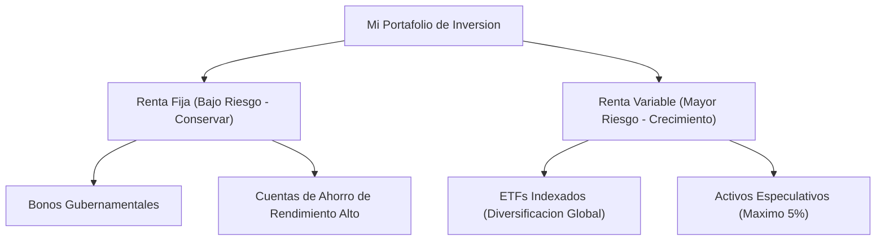

### Subtema 3.2.2: Diversificación y el Peligro del Dinero Rápido (Evitar FOMO)

El principal enemigo del inversor novato es el **FOMO (Fear of Missing Out)** o miedo a perderse algo. Es la emoción que te empuja a comprar criptomonedas especulativas, entrar a esquemas multinivel arriesgados o participar en "inversiones seguras del 20% mensual" porque viste a alguien en redes sociales presumir de ganancias rápidas.

- **La diversificación es tu único escudo real**: Nunca pongas más del 5% de tu capital en un solo activo individual de alto riesgo.
- Las ganancias rápidas suelen venir acompañadas de riesgos de pérdida total. La riqueza real se construye de forma aburrida, constante y sistemática.

---

## 3. Tema 3.3: Hábitos Diarios de Densidad Financiera

La arquitectura de tu riqueza está hecha de micro-decisiones diarias.

### Subtema 3.3.1: Rutinas Matutinas de Planificación

Los constructores de riqueza no improvisan su día. Dedican los primeros 10-15 minutos de la mañana a revisar sus prioridades estratégicas, lo que incluye:

- Revisar que sus gastos del día anterior coincidan con su presupuesto planificado.
- Enfocar su energía en la actividad de mayor retorno temporal del día (identificada en su plan de Skill Stacking del Módulo 2).

### Subtema 3.3.2: La Regla de las 24 Horas

Para neutralizar la compra por impulso emocional, aplica esta regla estricta:
Cuando sientas el deseo de comprar algo no esencial que supere el 10% de tu presupuesto semanal disponible:

1. **Espera 24 horas antes de pagar**.
2. Durante ese tiempo, la oleada de dopamina inicial (que te empuja a comprar por emoción) se disipará.
3. Al día siguiente, evalúa con tu corteza prefrontal activa si el objeto sigue pareciendo tan necesario o si prefieres destinar ese dinero a tu cuenta de inversión automatizada.


---

# Ejercicios Prácticos: Módulo 3 (Finanzas Prácticas)

## Ejercicio 1: Diseño de tu Presupuesto Inverso Automatizado

**Objetivo**: Establecer tu flujo automatizado de ahorro e inversión mensual para que el dinero trabaje por ti sin depender de tu fuerza de voluntad.

### Instrucciones

1. **Define tu porcentaje de inversión**: Si partes de cero, te recomendamos iniciar con un **10%** de tus ingresos netos mensuales.
2. **Calcula los montos** de tu presupuesto inverso completando la siguiente estructura:

- (A) Ingresos mensuales netos promedio: $****\_\_\_\_\_\_\_\_\_\_**** pesos
- (B) Porcentaje de inversión objetivo: ****\_\_\_\_\_**** % (ej. 10%, 15%, 20%)
- (C) Monto de Inversión Mensual = (A) × (B) = **$****\_\_\_\_\_\_\_\_\_\_**** pesos**
- (D) Dinero disponible para gastos = (A) - (C) = **$****\_\_\_\_\_\_\_\_\_\_**** pesos**

1. **Configura la automatización**: Escribe los pasos específicos que darás en la banca virtual de tu banco para automatizar esta transferencia el día del cobro (ej: "Crear una transferencia programada mensual los días 30 de cada mes desde mi cuenta corriente hacia la cuenta de inversión por el monto (C)").
   - _Paso 1:_ ****************************\_\_\_****************************
   - _Paso 2:_ ****************************\_\_\_****************************

---

## Ejercicio 2: El Costo Real de tus Gastos Hormiga

**Objetivo**: Cuantificar el impacto del dinero que gastas en micro-consumos diarios si se invirtiera con interés compuesto a largo plazo.

### Instrucciones

1. **Identifica** 3 "gastos hormiga" recurrentes que realices a la semana (ej. café de cafetería, comida rápida a domicilio, suscripciones de streaming que no utilizas).
2. **Calcula** el costo mensual de cada uno:

| Gasto Hormiga        | Costo Unitario ($) | Frecuencia Semanal  | Costo Mensual ($) (Costo x Frecuencia x 4) |
| :------------------- | :----------------- | :------------------ | :----------------------------------------- |
| Ejemplo: Café diario | $3.50 pesos        | 5 veces a la semana | $70 pesos                                  |
| 1.                   |                    |                     |                                            |
| 2.                   |                    |                     |                                            |
| 3.                   |                    |                     |                                            |
|                      |                    | **TOTAL MENSUAL:**  | **$****\_\_\_**** pesos**                  |

1. **Cálculo de Proyección a Futuro**: Si decides recortar el total mensual al 50% e invertir el otro 50% restante a una tasa del 8% de retorno anual compuesto:
   - Monto mensual invertido: **$****\_\_\_**** pesos** (Total Mensual / 2)
   - Valor acumulado nominal en 10 años: **$****\_\_\_**** pesos** (Monto mensual × 120 meses)
   - Valor real acumulado con interés compuesto (8%) a 10 años: **$****\_\_\_**** pesos**

> _(Nota de ayuda: cada $10 pesos invertidos al mes al 8% se transforman en ~$1,800 pesos en 10 años. Si tu monto es $50 pesos al mes, acumularás ~$9,000 pesos)._

---

## Ejercicio 3: Estructura de tu Asignación de Activos Básica

**Objetivo**: Diseñar una distribución de portafolio indexada básica y diversificada según tu nivel de tolerancia al riesgo.

### Instrucciones

Selecciona una de las siguientes tres carteras estándar para principiantes:

- [ ] **Conservadora** (70% Renta Fija - 30% Renta Variable): Para personas cercanas al retiro o con muy baja tolerancia a las fluctuaciones del mercado.
- [ ] **Moderada** (50% Renta Fija - 50% Renta Variable): Equilibrio entre estabilidad y crecimiento.
- [ ] **Crecimiento/Agresiva** (20% Renta Fija - 80% Renta Variable): Para jóvenes con horizonte de inversión mayor a 10 años y alta tolerancia a la volatilidad.

Dibuja y distribuye tu monto mensual de inversión (del Ejercicio 1, dato C) de acuerdo con el perfil seleccionado:

```
Total a Invertir al Mes: $___________ pesos (Dato C)
  │
  ├──► Renta Fija (Bonos/ CDT/ Depósito plazo):
  │    ___________% = $___________ pesos
  │
  └──► Renta Variable (Fondos Indexados/ ETFs):
       ___________% = $___________ pesos
```


---

# Evaluación: Módulo 3 (Finanzas Prácticas)

**Nombre del estudiante:** ___________________________  
**Fecha:** ___________________________

---

## Preguntas Teóricas y de Análisis

### 1. ¿Cuál es el error de la fórmula de ahorro tradicional (Ahorro = Ingresos - Gastos) y qué propone en su lugar el Presupuesto Inverso?
____________________________________________________________________________________________________________________________________________________________________________________________________________________________________

### 2. Explica la "Ley de Parkinson" y cómo la automatización de las transferencias de inversión ayuda a mitigar su efecto en el comportamiento de consumo cotidiano:
____________________________________________________________________________________________________________________________________________________________________________________________________________________________________

### 3. Describe la diferencia principal entre Renta Fija y Renta Variable en términos de riesgo, retorno esperado e idoneidad para un inversor principiante:
____________________________________________________________________________________________________________________________________________________________________________________________________________________________________

### 4. ¿Qué es un Fondo Indexado (ETF) y por qué se le considera una de las herramientas de inversión pasiva más eficientes y seguras para construir riqueza a largo plazo?
____________________________________________________________________________________________________________________________________________________________________________________________________________________________________

### 5. ¿Qué es el "FOMO" en las inversiones y por qué empuja a las personas a participar en esquemas fraudulentos o especulativos? Describe una regla práctica para evitarlo:
____________________________________________________________________________________________________________________________________________________________________________________________________________________________________


---

# MODULO 4

# Módulo 4: Ejecución, Resiliencia y Superación de Obstáculos

**Tiempo estimado**: 480 minutos (8 horas)  
**Nivel**: Intermedio (Ruta principal)  
**Fase**: Fase 4 — Ejecución de Tracción Rápida  
**Prerrequisitos**: Módulos 0, 1, 2 y 3 completados

---

## 1. Tema 4.1: Acción Imperfecta y Velocidad de Implementación

Muchas personas nunca inician sus proyectos financieros o de negocio porque esperan el "momento ideal" o creen que necesitan una planificación perfecta. Esto es un autoengaño cognitivo para evitar el miedo al fracaso. La realidad es que el mercado premia la **velocidad de implementación** y la **acción imperfecta**.

### Subtema 4.1.1: Parálisis por Análisis vs. Ejecución Ágil

La **parálisis por análisis** ocurre cuando dedicas tanto tiempo a sobreanalizar situaciones, buscar información adicional, prever problemas hipotéticos y planificar, que terminas agotando tu energía y perdiendo la oportunidad de actuar.

- En el desarrollo de productos modernos se aplica el principio de **ejecución ágil**: es mejor lanzar una versión imperfecta hoy y corregirla basándose en datos reales del mercado, que esperar a tener un producto perfecto que nadie quiere comprar.
- La perfección es enemiga de la ejecución. La información más valiosa solo se obtiene cuando interactúas de forma real con clientes y el mercado.

### Subtema 4.1.2: Validación Rápida de Ideas (MVP Personal)

El **Producto Mínimo Viable (MVP)** es la versión más simplificada y económica de tu idea que te permite probar si hay demanda real de clientes que estén dispuestos a pagar por ella.

- _Ejemplo_: Si quieres abrir una repostería, no alquiles un local ni compres maquinaria costosa (riesgo alto de pérdida). En su lugar, hornea 20 pasteles en tu cocina el fin de semana, crea una página de Instagram básica y ofrécelos a tus conocidos. Si logras venderlos y recibir pedidos adicionales, habrás validado la demanda con costo casi cero.

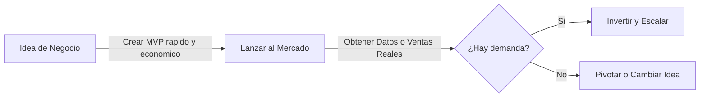

---

## 2. Tema 4.2: La Neurociencia del Fracaso y la Resiliencia

El camino hacia la riqueza está plagado de fallos, rechazos y errores. La resiliencia no es optimismo ciego; es una capacidad cognitiva que se puede entrenar.

### Subtema 4.2.1: Desensibilización al Rechazo

El cerebro humano procesa el rechazo social utilizando las mismas redes neuronales que procesan el **dolor físico** (la corteza cingulada anterior). Por eso, el miedo al rechazo ("no" del cliente, crítica de los pares) se siente biológicamente doloroso.

- Para mitigar este dolor, aplicamos la **desensibilización sistemática** o "terapia del rechazo" (popularizada por Jia Jiang). Consiste en exponerte voluntariamente a situaciones inofensivas de rechazo seguro para acostumbrar a tu amígdala a que el rechazo no representa una amenaza real de muerte. Al cabo de unos días de práctica, la respuesta de pánico se extingue.

### Subtema 4.2.2: Reencuadre Cognitivo del Fracaso como Feedback

El fracaso no define quién eres; define el resultado de una acción bajo ciertas variables. Los millonarios reencuadran el fracaso aplicando el método científico:

- Un experimento fallido en un laboratorio no hace llorar al científico; le da **datos valiosos** sobre lo que no funciona.
- Si una campaña de ventas fracasa, no significa "soy malo para las ventas"; significa: "esta propuesta de valor o este canal de distribución no resonó con esta audiencia específica bajo estas condiciones". Ajusta las variables y realiza el siguiente experimento.

---

## 3. Tema 4.3: Mitigación de Pérdidas y Pivotaje

Asumir riesgos no es equivalente a ser un apostador imprudente. Los millonarios son expertos en gestionar y mitigar la ruina.

### Subtema 4.3.1: Saber Cuándo Retirarse y Cuándo Duplicar

Existe un sesgo cognitivo llamado **sesgo del costo hundido**: la tendencia a continuar invirtiendo tiempo o dinero en un proyecto perdedor simplemente porque "ya he invertido mucho en él".

- Debes definir **límites de pérdidas** claros antes de iniciar cualquier proyecto (ej. "no invertir más de $500 pesos ni más de 3 meses sin obtener la primera venta"). Si se supera ese límite sin tracción real, lo más inteligente es cortar pérdidas, aprender de los datos y pivotar (cambiar la estrategia o el enfoque) hacia una alternativa más viable.

### Subtema 4.3.2: Construcción de un Colchón de Seguridad Anti-Ruina

Nunca arriesgues el dinero que necesitas para cubrir tus costos de vida básicos. La tranquilidad psicológica de tener un **Fondo de Emergencia** (equivalente a 3 a 6 meses de tus gastos fijos mensuales) depositado en un activo líquido de renta fija es lo que te permite tomar riesgos calculados en tus proyectos productivos. Sin este colchón, la visión de túnel del miedo bloqueará tu capacidad de innovación y toma de decisiones a largo plazo.


---

# Ejercicios Prácticos: Módulo 4 (Ejecución y Resiliencia)

## Ejercicio 1: Diseño de tu MVP Personal de Costo Cero

**Objetivo**: Estructurar la validación de una idea de generación de valor en menos de 7 días y sin gastar capital.

### Instrucciones

1. **Piensa en una idea** de producto o servicio que puedas ofrecer basada en tu Skill Stacking (ej: consultoría sobre tu área, servicio de diseño, venta de un producto artesanal).
2. **Define tu MVP** respondiendo las siguientes preguntas:

* ¿Cuál es la versión mínima de mi idea que puedo ofrecer hoy? (ej. "ofrecer una sesión de asesoría gratuita de 30 minutos a 5 conocidos para validar interés").
  * *Respuesta:* ___________________________________________________________
* ¿Qué canal gratuito utilizaré para contactar a mis clientes potenciales? (WhatsApp, LinkedIn, Instagram personal, llamada directa).
  * *Respuesta:* ___________________________________________________________
* ¿Cuál es mi métrica de éxito de validación? (ej: "lograr que al menos 2 personas reserven la asesoría o demuestren interés real en pagar por el servicio completo").
  * *Respuesta:* ___________________________________________________________

1. **Lanzamiento**: Comprométete a enviar el mensaje u oferta de validación en las próximas 48 horas. Anota la fecha de ejecución: ****/****/____.

---

## Ejercicio 2: Terapia del Rechazo (Desensibilización Sistemática)

**Objetivo**: Entrenar tu amígdala para tolerar el dolor emocional del rechazo, desactivando la respuesta de pánico biológico.

### Instrucciones

1. Durante esta semana, realiza una solicitud inusual pero inofensiva a un extraño o conocido con la intención deliberada de recibir un "No" como respuesta.
    * *Ejemplos*:
        * Pedir un descuento del 10% al comprar un café en una tienda común.
        * Pedir prestado un bolígrafo a alguien en la calle y preguntar si te lo puedes quedar de regalo.
        * Preguntar en un restaurante si pueden servirte comida en un envase no convencional.
2. **Ejecuta la acción**.
3. **Registra la experiencia**:
    * ¿Cuál fue la solicitud realizada? ___________________________________________
    * ¿Cuál fue la respuesta exacta de la persona? _______________________________
    * ¿Cómo te sentiste físicamente antes de preguntar? (ej: taquicardia, sudoración) ____________________________________________________________________
    * ¿Qué aprendiste sobre el rechazo tras finalizar el ejercicio? ____________________________________________________________________

---

## Ejercicio 3: Establecer el Límite de Costo Hundido

**Objetivo**: Blindar tus finanzas contra el sesgo del costo hundido mediante la definición previa de límites objetivos en tus proyectos.

### Instrucciones

Para el proyecto de generación de valor o MVP que diseñaste en el Ejercicio 1:

1. **Define el presupuesto máximo de dinero** que estás dispuesto a perder por completo antes de cancelar el proyecto: **$___________ pesos** (Debería ser una suma que no afecte tu Fondo de Emergencia).
2. **Define el límite máximo de tiempo** (en horas semanales y semanas totales) que invertirás antes de evaluar si pivotas o descartas la idea: **___________ horas/semana por ___________ semanas**.
3. **Define el criterio objetivo de continuación**: ¿Qué debe pasar para que decidas continuar invirtiendo (ej. "lograr la primera venta real", "recibir retroalimentación positiva escrita de al menos 3 usuarios")?
    * *Criterio:* ___________________________________________________________


---

# Evaluación: Módulo 4 (Ejecución y Resiliencia)

**Nombre del estudiante:** ___________________________  
**Fecha:** ___________________________

---

## Preguntas Teóricas y de Análisis

### 1. ¿Qué es la "parálisis por análisis" y cómo puede el concepto de "acción imperfecta" ayudar a superarla en el ámbito del emprendimiento?
____________________________________________________________________________________________________________________________________________________________________________________________________________________________________

### 2. Define "Producto Mínimo Viable" (MVP). Explica cómo un emprendedor novato puede validar una idea de negocio reduciendo su riesgo financiero a cero:
____________________________________________________________________________________________________________________________________________________________________________________________________________________________________

### 3. Desde la neurociencia cognitiva, ¿cómo procesa el cerebro el rechazo social y cómo ayuda la técnica de desensibilización sistemática a mitigar este dolor emocional?
____________________________________________________________________________________________________________________________________________________________________________________________________________________________________

### 4. Explica el "sesgo de costo hundido" y proporciona una estrategia práctica para evitar caer en él al gestionar un negocio o proyecto perdedor:
____________________________________________________________________________________________________________________________________________________________________________________________________________________________________

### 5. ¿Qué es el "Fondo de Emergencia" y por qué se considera el cimiento psicológico necesario para tomar riesgos calculados e innovar financieramente?
____________________________________________________________________________________________________________________________________________________________________________________________________________________________________


---

# MODULO 5

# Módulo 5: Propósito, Libertad Financiera y Legado

**Tiempo estimado**: 420 minutos (7 horas)  
**Nivel**: Intermedio-Avanzado (Ruta principal)  
**Fase**: Fase 5 — Integración de Vida y Trascendencia  
**Prerrequisitos**: Módulos 0, 1, 2, 3 y 4 completados

---

## 1. Tema 5.1: El Propósito como Motor

El dinero es un combustible extraordinario, pero es un pésimo propósito de vida. Quienes se enfocan únicamente en "ganar dinero" suelen cansarse rápidamente ante las primeras dificultades o, si lo consiguen, experimentan un vacío emocional profundo. Para construir riqueza sostenible, debes vincular tu actividad con un **propósito real de generación de valor**.

### Subtema 5.1.1: El Ikigai Financiero y el Valor Genuino

El **Ikigai** es un concepto japonés que significa "la razón de ser" o "la razón para levantarse por la mañana". Se representa como la intersección de cuatro grandes áreas de tu vida:

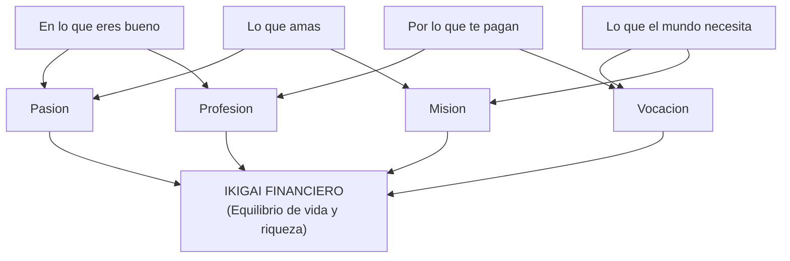

En las finanzas personales, buscamos el **Ikigai Financiero**:

- No basta con hacer lo que amas si el mercado no está dispuesto a pagar por ello.
- No basta con hacer algo bien pagado si odias realizarlo a diario (lo que conduce al agotamiento o _burnout_ y a gastar tu dinero en pasivos de escape emocional).
- El equilibrio consiste en encontrar una habilidad atómica que ames y en la que seas bueno, y que a la vez satisfaga una necesidad real del mercado por la que estén dispuestos a pagarte de forma recurrente.

### Subtema 5.1.2: El Dinero Persigue al Valor

Esta es la ley física del dinero: **el dinero es el eco del valor generado**.

- Si intentas "perseguir el dinero" directamente (mediante atajos o trucos rápidos), el dinero se alejará de ti.
- Si te enfocas en **resolver problemas reales** y aportar valor de forma masiva a otras personas (creando un producto útil, optimizando un servicio, facilitando la vida de los demás), el dinero llegará a ti como una consecuencia natural e inevitable.

---

## 2. Tema 5.2: Libertad Financiera Sostenible

La libertad financiera no consiste en tener carros de lujo o yates; consiste en **recuperar la propiedad sobre tu tiempo**. Es el punto en el que los ingresos pasivos de tus activos cubren la totalidad de tus gastos de vida.

### Subtema 5.2.1: Libertad vs. Riqueza Ostentosa

- **Riqueza Ostentosa**: Consiste en tener altos ingresos y gastarlos de inmediato en pasivos caros para mostrar estatus a los demás. Requiere trabajar constantemente para mantener el estilo de vida. Eres esclavo del flujo de ingresos.
- **Libertad Financiera**: Consiste en vivir por debajo de tus posibilidades y acumular activos. Si tus gastos mensuales son de $1,500 pesos y tus activos (fondos indexados, propiedades en alquiler) generan $1,600 pesos de forma pasiva, eres financieramente libre, independientemente de tu saldo total. Ya no necesitas trabajar por dinero.

### Subtema 5.2.2: Plan de Retiro y la Regla del 4%

La **regla del 4%** (derivada del célebre _Estudio Trinity_ de 1998) es el estándar matemático utilizado para calcular tu número de retiro. Establece que puedes retirar de forma segura el 4% anual de tu portafolio de inversión (ajustado por inflación) durante al menos 30 años sin riesgo de que el dinero se agote.

Para calcular tu **Número de Libertad Financiera (Número FI)**, aplica la siguiente fórmula:

$$\text{Número FI} = \text{Gastos Anuales} \times 25$$

#### Caso Práctico

Supongamos que tus gastos anuales para vivir cómodamente son de $18,000 pesos ($1,500 pesos al mes):

- Tu Número FI es: $18,000 \times 25 =$ **$450,000 pesos**.
- Si acumulas $450,000 pesos en un portafolio indexado diversificado (como el MSCI World), puedes retirar el 4% anual ($18,000 pesos, o $1,500 pesos al mes) indefinidamente, ajustando el retiro por inflación cada año, sin que tu capital principal se destruya en escenarios históricos normales de mercado.

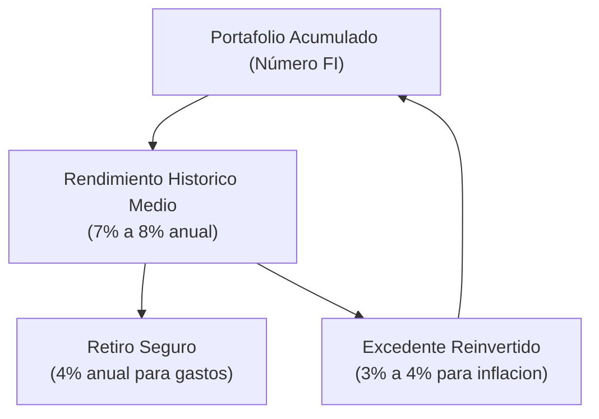

---

## 3. Tema 5.3: Construcción de Legado y Filantropía

La acumulación de riqueza personal es solo la primera etapa del éxito financiero. La verdadera trascendencia se logra cuando tu riqueza sirve para impactar positivamente al mundo que te rodea.

### Subtema 5.3.1: Sistemas y Empresas que Trascienden

Los millonarios más influyentes dedican la última etapa de sus vidas a construir sistemas independientes de su presencia física que resuelven problemas sociales de gran escala (como fundaciones, fideicomisos educativos, o empresas con propósito social integrado).

- Crear empleo digno y desarrollar infraestructura productiva útil en tu comunidad es una de las formas de filantropía más poderosas y sostenibles que existen.

### Subtema 5.3.2: Devolución de Valor a la Comunidad

La riqueza real incluye la gratitud y la generosidad. Contribuir al desarrollo de otros (mediante mentorías gratuitas, donaciones a causas verificadas de educación o salud, o financiamiento de proyectos locales) no solo mejora la sociedad, sino que reprograma tu cerebro eliminando el miedo a la escasez. Dar es la confirmación definitiva de que tu mente opera bajo un marco de abundancia real.


---

# Ejercicios Prácticos: Módulo 5 (Propósito y Legado)

## Ejercicio 1: Mapeo de tu Ikigai Financiero

**Objetivo**: Alinear tus habilidades técnicas y pasiones personales con una necesidad real y rentable del mercado.

### Instrucciones

1. **Completa** las cuatro listas a continuación con la mayor honestidad posible:

* **Lista 1: Lo que te apasiona** (actividades que realizas por placer sin recibir pago):
    ________________________________________________________________________________
* **Lista 2: Habilidades en las que eres bueno** (o que te resultan más fáciles de aprender que al promedio):
    ________________________________________________________________________________
* **Lista 3: Lo que el mundo necesita** (problemas sin resolver, ineficiencias en el trabajo o necesidades de tu comunidad):
    ________________________________________________________________________________
* **Lista 4: Por lo que te pueden pagar** (servicios o productos existentes por los cuales la gente ya intercambia dinero en el mercado):
    ________________________________________________________________________________

1. **Identifica la intersección**: Escribe 1 idea concreta que combine elementos de las cuatro listas (ej: "ofrecer capacitación en automatización de procesos administrativos [Habilidad + Pago] para pymes locales que pierden tiempo organizando facturas [Mundo necesita] utilizando metodologías de enseñanza dinámicas [Pasión]").
    * *Idea Ikigai:* ________________________________________________________________________________

---

## Ejercicio 2: Cálculo de tu Número de Libertad Financiera (Número FI)

**Objetivo**: Establecer la meta matemática exacta de capital que necesitas acumular para lograr tu independencia temporal definitiva.

### Instrucciones

1. **Estima tus gastos mensuales ideales de libertad** (aquellos con los que vivirías de forma cómoda, sin excesos ostentosos pero cubriendo todas tus necesidades reales): **$___________ pesos al mes**.
2. **Calcula tus gastos anuales**:
    $$\text{Gastos Anuales (GA)} = \text{Gastos Mensuales} \times 12 = \mathbf{\$\_\_\_\_\_\_\_\_\_\_\_ pesos/año}$$
3. **Aplica la regla del 4% (Fórmula Trinity)**:
    $$\mathbf{Número\ FI} = \text{Gastos Anuales (GA)} \times 25 = \mathbf{\$\_\_\_\_\_\_\_\_\_\_\_ pesos}$$

4. **Reflexión**: Si logras una tasa de ahorro e inversión de tu Presupuesto Inverso (Módulo 3) de $___________ pesos al mes, e invirtiendo al 8% de retorno anual compuesto, ¿cuántos años tardarás aproximadamente en alcanzar tu Número FI?
    *(Nota de ayuda: ahorrar $300 pesos/mes al 8% compuesto te permite acumular ~$100,000 pesos en 15 años y ~$450,000 pesos en 30 años).*
    * Proyección estimada: **___________ años**.

---

## Ejercicio 3: Tu Plan de Retorno de Valor (Legado Social)

**Objetivo**: Estructurar un hábito de generosidad que rompa la mentalidad de escasez y comience a impactar positivamente tu comunidad desde hoy.

### Instrucciones

1. No necesitas esperar a ser millonario para generar un legado. Define 1 acción de costo económico cero (o muy bajo, menor a $10 pesos) que puedas realizar esta semana para devolver valor a otros.
    * *Ejemplos*:
        * Dedicar 1 hora a guiar o enseñar una habilidad técnica tuya a un estudiante o colega junior de forma gratuita.
        * Donar libros que ya leíste y que transformaron tu mentalidad a una biblioteca local o a un amigo.
        * Participar en una jornada de voluntariado ambiental o social en tu barrio.
2. **Describe tu plan**:
    * ¿Qué acción realizarás? ___________________________________________
    * ¿A quién beneficiará? _____________________________________________
    * ¿Cuándo la ejecutarás? ****/****/____


---

# Evaluación: Módulo 5 (Propósito y Legado)

**Nombre del estudiante:** ___________________________  
**Fecha:** ___________________________

---

## Preguntas Teóricas y de Análisis

### 1. ¿Por qué se afirma que el dinero es un gran combustible pero un mal propósito de vida para construir riqueza sostenible?

____________________________________________________________________________________________________________________________________________________________________________________________________________________________________

### 2. Explica el concepto japonés de "Ikigai" aplicado al ámbito financiero y qué ocurre cuando una persona se enfoca únicamente en lo que ama sin considerar la rentabilidad del mercado:

____________________________________________________________________________________________________________________________________________________________________________________________________________________________________

### 3. Describe la diferencia operativa entre "Riqueza Ostentosa" y "Libertad Financiera Sostenible":
____________________________________________________________________________________________________________________________________________________________________________________________________________________________________

### 4. Explica detalladamente en qué consiste la "regla del 4%" (derivada del Estudio Trinity) y cuál es la fórmula matemática para calcular tu Número de Libertad Financiera (Número FI):

____________________________________________________________________________________________________________________________________________________________________________________________________________________________________

### 5. ¿Por qué la devolución de valor a la comunidad y la filantropía no son actividades exclusivas de personas ricas? ¿Cómo influyen estos hábitos en la psicología del inversor frente al miedo a la escasez?

____________________________________________________________________________________________________________________________________________________________________________________________________________________________________


---

