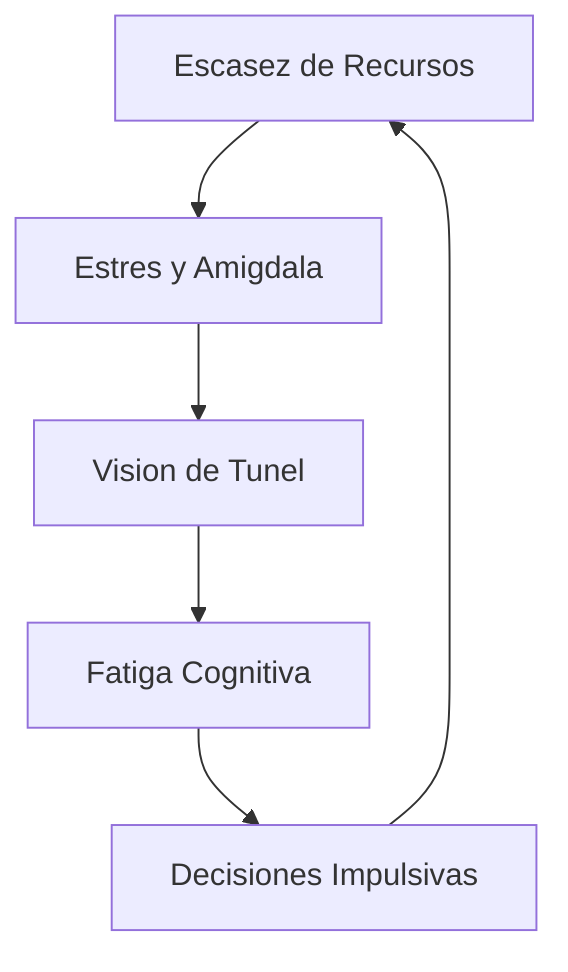
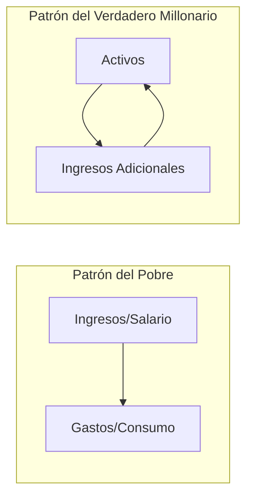

# Módulo 0: Diagnóstico y Nivelación (Preconceptos)

**Tiempo estimado**: 180 minutos  
**Nivel**: Básico (Ruta principal)  
**Fase**: Fase 0 — Nivelación de Entrada  
**Prerrequisitos**: Ninguno — Módulo base del curso

---

## 1. La Naturaleza del Dinero: Conceptos de Deuda y Valor

Para transformar tu relación con la riqueza, primero debes entender qué es realmente el dinero. La mayoría de las personas creen que el dinero es un objeto físico o un papel con valor intrínseco. Históricamente no es así. El dinero es, fundamentalmente, una **herramienta de contabilidad social** y una **representación de valor depositado**.

### De la Reserva de Valor al Dinero Fiduciario

En la antigüedad, las sociedades utilizaban el trueque o mercancías con valor intrínseco (oro, plata, sal) como medios de intercambio. Sin embargo, el dinero moderno es **dinero fiduciario** (del latín _fiducia_, que significa confianza). No está respaldado por oro ni plata; su valor reside únicamente en la confianza mutua de que el gobierno y la sociedad lo aceptarán como pago de bienes y servicios.

El dinero es un intermediario de la energía humana. Cuando trabajas, entregas tu tiempo y tu habilidad (energía) al mercado, y a cambio recibes dinero (un certificado de valor acumulado). Cuando compras algo, intercambias ese certificado por la energía de otra persona.

### La Relación con la Deuda: Esclavitud vs. Apalancamiento

En el sistema financiero moderno, el dinero nuevo se crea principalmente a través de la deuda (mediante el sistema de reserva fraccional bancario). La deuda tiene dos caras:

1. **Deuda de consumo (Esclavitud financiera)**: Pedir prestado para comprar pasivos (como vacaciones, ropa o un carro de lujo). Intercambias tu libertad y trabajo futuro para pagar intereses por algo que pierde valor de forma inmediata.
2. **Deuda productiva (Apalancamiento)**: Usar el dinero de otros (crédito) para adquirir activos que generen un retorno mayor que la tasa de interés de la deuda. Esto es lo que los millonarios denominan "deuda buena".

> [!NOTE]
> La regla de oro del dinero: El mercado no te paga por tu esfuerzo o por tu necesidad; te paga por el **valor percibido** que aportas en función de resolver problemas de otras personas.

---

## 2. Mentalidad: Abundancia vs. Escasez (Neurociencia de la Escasez)

La mentalidad no es una actitud mística; es una configuración biológica y neurológica de cómo tu cerebro procesa las amenazas y las oportunidades.

### La Neurociencia de la Escasez

Estudios liderados por el economista Sendhil Mullainathan y el psicólogo Eldar Shafir demuestran que experimentar escasez (ya sea de tiempo, dinero o atención) altera la capacidad cognitiva de manera mensurable. Este fenómeno se conoce como **"visión de túnel"**.

Cuando el cerebro percibe que no hay suficiente dinero para cubrir las necesidades inmediatas, activa la amígdala y el sistema de respuesta al estrés (cortisol e histamina). Esto produce:

- **Reducción del ancho de banda cognitivo**: Disminución temporal de hasta 13 puntos de coeficiente intelectual funcional.
- **Enfoque exclusivo a corto plazo**: Incapacidad neurológica de planificar a largo plazo porque la supervivencia inmediata consume toda la atención disponible.
- **Toma de decisiones impulsivas**: Decisiones financieras erróneas (como préstamos gota a gota o compras desesperadas) debido a la fatiga de decisión.



### La Mentalidad de Abundancia como Herramienta Pragmática

La abundancia no consiste en creer ingenuamente que todo es ilimitado. Es la habilidad cognitiva de desactivar la visión de túnel del estrés y enfocar el cerebro en la **creación de soluciones e identificación de oportunidades**.

Mientras que la escasez te hace competir por recursos limitados (un pastel pequeño), la abundancia te lleva a pensar en cómo hornear un pastel más grande mediante la colaboración y el desarrollo de nuevas habilidades.

---

## 3. Activos vs. Pasivos: El Balance Personal Simple

La definición tradicional de la contabilidad corporativa a menudo confunde a las personas en su economía personal. Por eso adoptamos la definición simplificada e hiper-operativa de Robert Kiyosaki:

- **Activo**: Todo aquello que **pone dinero en tu bolsillo**, trabajes o no.
- **Pasivo**: Todo aquello que **saca dinero de tu bolsillo** constantemente.

### La paradoja de la casa propia

Para la contabilidad de un banco, tu casa es un activo (para ellos, porque tú les pagas intereses). Pero para tu balance personal, la casa donde vives es un **pasivo** (genera gastos de hipoteca, impuestos, seguros, servicios y mantenimiento mensual). Solo se convierte en un activo si la alquilas a un tercero y el ingreso neto mensual supera todos los costos asociados.

| Activos Reales                                                    | Pasivos Frecuentes                                  |
| :---------------------------------------------------------------- | :-------------------------------------------------- |
| Negocios automatizados o franquicias                              | Préstamos de tarjetas de crédito                    |
| Propiedades de alquiler netas                                     | Automóvil de uso personal (crédito + mantenimiento) |
| Acciones, bonos o fondos indexados                                | Ropa de diseñador o tecnología de moda a crédito    |
| Activos intangibles (derechos de autor, patentes, cursos propios) | Suscripciones no utilizadas                         |

### El Flujo de Caja (Cashflow)

La riqueza no se mide por cuánto ganas, sino por la dirección de tu flujo de caja:



---

## 4. Interés Compuesto e Inflación: La Fórmula de la Bola de Nieve

El interés compuesto es la fuerza multiplicativa más poderosa de las finanzas. Ocurre cuando los intereses generados por una inversión se reinvierten para generar nuevos intereses en el siguiente período.

### La Matemática del Interés Compuesto

La fórmula matemática para calcular el valor futuro ($VF$) con interés compuesto es:

$$VF = VI \times (1 + r)^t$$

Donde:

- $VI$ = Valor Inicial (tu capital de partida).
- $r$ = Tasa de interés anual (expresada en decimal).
- $t$ = Tiempo en años que dejas correr la inversión.

#### El Efecto Bola de Nieve: Un ejemplo real

Imagina dos personas, Juan y María, que invierten $1,000 USD cada uno a una tasa del 10% anual de retorno estimado:

- **Juan** retira las ganancias cada año (Interés Simple): Después de 30 años, Juan habrá ganado $100 USD anuales ($3,000 USD en total), retirando al final sus $1,000 USD iniciales. Total acumulado: **$4,000 USD**.
- **María** reinvierte todas las ganancias (Interés Compuesto): Después de 30 años, sus $1,000 USD se habrán transformado en **$17,449.40 USD**. Las ganancias de los últimos años superan drásticamente a las de los primeros años.

El ingrediente crítico de esta ecuación no es la cantidad de dinero, sino el **tiempo ($t$)**.

### La Inflación: El Impuesto Silencioso

La inflación es el aumento generalizado y sostenido de los precios de los bienes y servicios, lo que equivale a la pérdida de poder adquisitivo del dinero. Si tu dinero rinde un 2% en una cuenta de ahorros tradicional pero la inflación anual es del 5%, estás perdiendo un 3% de tu riqueza real cada año. El dinero bajo el colchón no está seguro; se está evaporando lentamente.

---

## 5. Empleo vs. Emprendimiento: El Cuadrante Simplificado

Tu forma de generar ingresos determina tu relación con el tiempo y el potencial de tu riqueza. Adaptando el modelo de Robert Kiyosaki, dividimos el mercado en cuatro roles:

```
                  TIEMPO POR DINERO
            E (Empleado)    |    A (Autoempleo)
  --------------------------+--------------------------
            D (Dueño)       |    I (Inversionista)
                  SISTEMAS Y DINERO TRABAJANDO
```

1. **E (Empleado)**: Intercambias tiempo por un salario. Buscas seguridad, pero tus ingresos están limitados por las horas del día y la decisión de un tercero.
2. **A (Autoempleo)**: Eres tu propio jefe, pero si no trabajas, no hay ingresos (ej. médicos con consultorio, consultores independientes, freelance). Eres el engranaje principal de tu negocio.
3. **D (Dueño de negocio)**: Creas o controlas un sistema que funciona sin que estés físicamente allí. Empleas el tiempo de otros.
4. **I (Inversionista)**: Tu dinero trabaja para ti. Compras activos que generan más ingresos de forma pasiva.

Los verdaderos millonarios no se limitan a un solo cuadrante, sino que utilizan los ingresos de sus empleos o autoempleos para transicionar sistemáticamente hacia los cuadrantes **D** e **I**.
