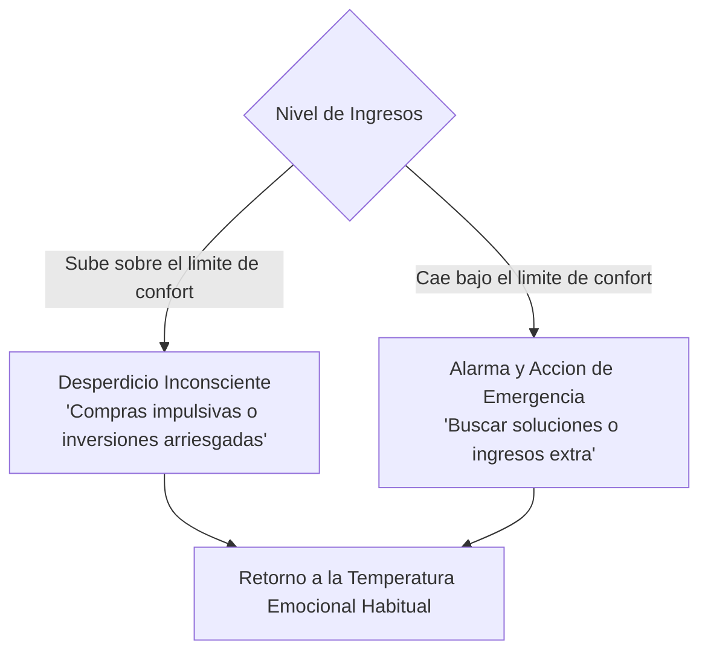
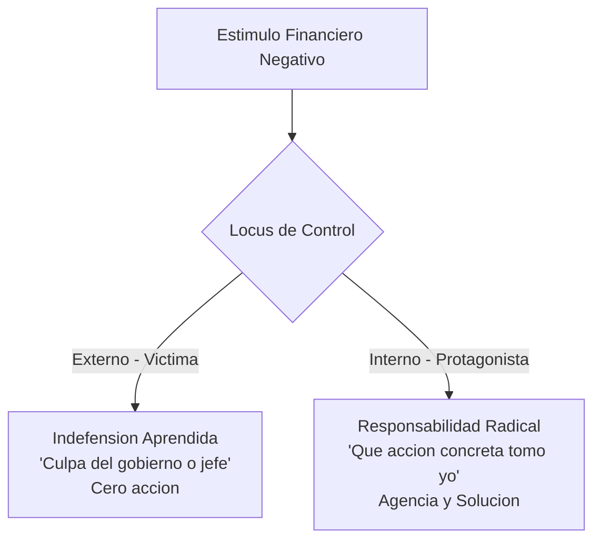
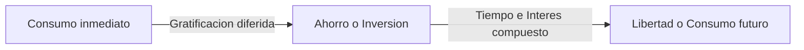

# Módulo 1: La Mentalidad del Creador de Riqueza

**Tiempo estimado**: 420 minutos (7 horas)  
**Nivel**: Básico-Intermedio (Ruta principal)  
**Fase**: Fase 1 — Desconstrucción del Mindset Limitado  
**Prerrequisitos**: Módulo 0 completado

---

## 1. Tema 1.1: Reconfiguración de Creencias Limitantes

Tu relación con el dinero no se rige por leyes matemáticas o decisiones puramente racionales. Se rige por tus **creencias nucleares**, que a menudo son inconscientes y se formaron en tu infancia.

### Subtema 1.1.1: Patrones Heredados y el "Termostato Financiero"

El concepto de **"termostato financiero"** o "termostato económico" es una analogía psicológica muy útil. Un termostato está programado para mantener una habitación a una temperatura fija. Si hace mucho frío, enciende la calefacción; si hace mucho calor, enciende el aire acondicionado.

En tu mente existe un termostato equivalente que determina la cantidad de dinero con la que te sientes "cómodo" operando.

- **Si tus ingresos caen por debajo de tu termostato**: Te alarmas, buscas soluciones de emergencia, trabajas horas extra y regresas a tu zona de confort.
- **Si tus ingresos suben significativamente por encima de tu termostato**: De manera inconsciente, tu mente busca cómo "deshacerse" del excedente (mediante compras impulsivas, préstamos incobrables a familiares, o inversiones arriesgadas mal planificadas) para regresar a la temperatura emocional habitual.

Este termostato se configura mediante el aprendizaje observacional en el núcleo familiar durante la infancia. Si escuchaste frases como "el dinero no crece en los árboles", "los ricos son malas personas" o "el dinero es sucio", tu cerebro grabó que el dinero es un recurso escaso y éticamente peligroso.

### Subtema 1.1.2: Reprogramación del Miedo a la Pérdida

El miedo a la pérdida es una respuesta evolutiva natural. Los seres humanos sufrimos de **aversión a la pérdida** (Kahneman y Tversky demostraron que el dolor de perder $100 pesos es emocionalmente el doble de intenso que el placer de ganar $100 pesos).

Para reprogramar este miedo, aplicamos el **reencuadre cognitivo**:

1. **Aceptar la incertidumbre como dato**: En el ámbito financiero, el riesgo cero no existe. Incluso el efectivo pierde valor por la inflación (como vimos en el Módulo 0).
2. **Definir el peor escenario posible (Fear Setting)**: Desglosar matemáticamente qué pasaría si pierdes una inversión atómica. Al ver que el peor escenario no significa la ruina absoluta sino una pérdida controlada de la que puedes recuperarte, la amígdala reduce su respuesta de pánico.

---

## 2. Tema 1.2: Responsabilidad Radical e "Internal Locus of Control"

La diferencia fundamental entre una persona con mentalidad de riqueza y una con mentalidad de pobreza no es el saldo de su cuenta bancaria, sino su explicación causal del mundo.

### Subtema 1.2.1: Pasar de Víctima a Protagonista

El psicólogo Julian Rotter definió el **Locus de Control** como el grado en que las personas creen que tienen el control sobre los eventos que afectan sus vidas:

- **Locus de Control Externo (Mentalidad de Víctima)**: Creer que la situación financiera depende de la suerte, el gobierno, la economía nacional, el jefe o el destino. Conduce a la indefensión aprendida.
- **Locus de Control Interno (Mentalidad de Protagonista)**: Creer que, aunque existen factores externos incontrolables, tus decisiones y acciones son la variable principal que determina tu futuro.

La **Responsabilidad Radical** consiste en asumir el 100% de la responsabilidad de tus reacciones y decisiones financieras cotidianas, sin importar cuán injusto sea el entorno.

### Subtema 1.2.2: El Hábito del "Ownership"

_Ownership_ significa adueñarse de los resultados. En finanzas personales, significa dejar de justificar los gastos innecesarios ("me lo merecía", "estaba en oferta") y comenzar a registrar de forma objetiva las consecuencias de cada decisión. Asumir el ownership te devuelve el poder de cambiar tu realidad, porque si el problema es tuyo, la solución también lo es.

---

## 3. Tema 1.3: Visión Sistémica del Éxito y "Delay of Gratification"

La riqueza sostenible es un subproducto de la arquitectura de tus decisiones en el tiempo.

### Subtema 1.3.1: Metas Antifrágiles y "Delay of Gratification"

El famoso **"experimento del malvavisco de Stanford"** (Walter Mischel, 1972) demostró que los niños capaces de retrasar la gratificación inmediata (esperar 15 minutos para recibir dos malvaviscos en lugar de comer uno de inmediato) tenían, décadas después, mejores niveles de salud, menores tasas de divorcio y una situación económica significativamente mejor.

La gratificación diferida es el pilar de la inversión. Invertir es, por definición, el acto de sacrificar consumo hoy para tener mayor capacidad de consumo y libertad mañana.

### Subtema 1.3.2: El Costo Cognitivo de las Decisiones Inmediatas

Cada decisión que tomas consume glucosa en tu corteza prefrontal, un recurso biológico limitado. Esto se conoce como **fatiga de decisión**.
Las personas bajo constante presión financiera (escasez) agotan rápidamente este recurso resolviendo emergencias cotidianas, lo que incrementa drásticamente la probabilidad de que tomen decisiones de compra impulsivas al final del día.

Para combatir esto, los millonarios automatizan sus decisiones financieras (automatización de transferencias de inversión) para no depender de la fuerza de voluntad diaria.
