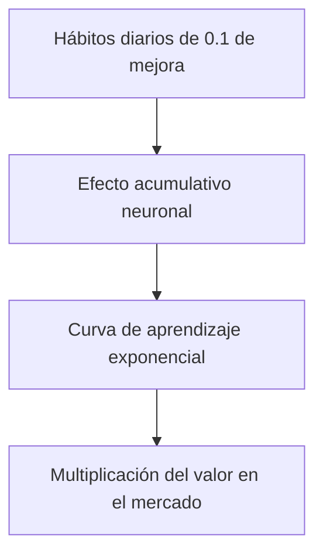

# Módulo 2: Arquitectura del Tiempo y Costo de Oportunidad

**Tiempo estimado**: 420 minutos (7 horas)  
**Nivel**: Intermedio (Ruta principal)  
**Fase**: Fase 2 — Optimización de Activos Intangibles  
**Prerrequisitos**: Módulos 0 y 1 completados

---

## 1. Tema 2.1: El Tiempo como Activo Finito

El dinero se puede perder y recuperar, se puede imprimir y se puede pedir prestado. El tiempo no. El tiempo es el único activo verdaderamente no renovable y democrático del ser humano (todos disponemos de 24 horas al día). Los verdaderos millonarios no valoran el dinero por encima de todo; valoran el dinero porque les permite comprar libertad de tiempo.

### Subtema 2.1.1: Cálculo de la Tasa Real por Hora

La mayoría de las personas calculan el valor de su tiempo de forma simplista: dividiendo su salario mensual por las horas que pasan en la oficina. Esto es un error financiero básico.
Para calcular tu **Tasa Real por Hora (TRH)**, debes aplicar la siguiente fórmula sistémica:

$$TRH = \frac{Ingresos\ Netos - Costos\ de\ Trabajo}{Horas\ de\ Trabajo + Horas\ de\ Transporte + Horas\ de\ Preparación}$$

- **Costos de Trabajo**: Transporte, almuerzos fuera de casa, ropa formal requerida, impuestos, comisiones, cuidado de niños extra, etc.
- **Horas de Transporte e Insumo**: El tiempo que pasas en el tráfico de ida y vuelta a la oficina, el tiempo que pasas en casa respondiendo correos pendientes o preparándote para el trabajo.

#### Caso Práctico

- **Cálculo tradicional**: Ganas $2,000 pesos netos al mes por 160 horas de oficina. Crees que tu tiempo vale **$12.50 pesos por hora**.
- **Cálculo real (TRH)**: Gastas $300 pesos al mes en transporte y comida fuera de casa. Además de las 160 horas de oficina, gastas 40 horas al mes en transporte y 10 horas respondiendo correos desde casa los fines de semana.
  - Ingresos reales netos: $1,700 pesos.
  - Horas reales invertidas: 210 horas.
  - Tasa Real por Hora: **$8.09 pesos por hora**.

Calcular tu TRH te permite tomar decisiones de compra más inteligentes. Si quieres comprar unos zapatos de $80 pesos, no pienses en el precio; piensa: _¿Vale la pena entregar 10 horas de mi vida real a cambio de estos zapatos?_

### Subtema 2.1.2: Apalancamiento del Tiempo de Otros (OPT)

Para escapar del cuadrante de Empleado o Autoempleado, debes aprender a **apalancarte**. Los millonarios compran el tiempo de otras personas para liberar el suyo propio y enfocarlo en tareas de alta rentabilidad (como crear sistemas o evaluar inversiones).

- **Si tú limpias tu casa** (costo de oportunidad: tu TRH es $30/h y contratar a alguien cuesta $10/h), estás perdiendo $20/h de valor neto potencial.
- **Delegar no es un gasto**: Es una compra estratégica de tiempo para enfocar tu energía en actividades que generen mayor retorno.

---

## 2. Tema 2.2: Interés Compuesto del Conocimiento (Efecto Snowball)

Al igual que el dinero, el conocimiento acumulado de forma sistemática y deliberada crece exponencialmente gracias al interés compuesto.

### Subtema 2.2.1: Curvas de Aprendizaje y Hábitos Atómicos

Según James Clear en su libro _Atomic Habits_, si logras mejorar una habilidad apenas un **1% cada día**, al cabo de un año serás **37 veces mejor** en esa habilidad.

La constancia en el estudio y la lectura de libros técnicos o científicos de tu área de especialización actúa como una bola de nieve de conocimiento que el mercado terminará pagando muy bien.

### Subtema 2.2.2: "Skill Stacking" (Apilamiento de Habilidades)

No necesitas ser el mejor del mundo en una sola habilidad (lo cual es extremadamente difícil y costoso). El camino más viable hacia la riqueza es el **Skill Stacking**: convertirte en alguien en el top 20% en 3 o 4 habilidades complementarias.

- _Ejemplo_: Si eres un programador promedio (top 50%), tus ingresos serán estándar. Pero si sumas habilidades de oratoria y ventas (top 20%) y diseño de interfaces de usuario (top 20%), te transformas en un profesional sumamente escaso y valioso, capaz de crear y vender sus propios sistemas.

---

## 3. Tema 2.3: Análisis de Costo de Oportunidad

Cada vez que dices "Sí" a algo, le estás diciendo automáticamente "No" a infinitas alternativas. El costo de oportunidad es el valor de la mejor opción que decides descartar al tomar una decisión.

### Subtema 2.3.1: Decisiones Bajo Incertidumbre

Al evaluar un proyecto o inversión, no debes medir únicamente el beneficio esperado; debes compararlo contra la rentabilidad de dejar tu dinero o tu tiempo en la opción alternativa más segura (como un fondo indexado o tu trabajo principal).
Si un nuevo negocio te da a ganar $500 pesos al mes pero te cuesta 30 horas de trabajo semanales, y en tu empleo actual ganarías $800 pesos por esas mismas 30 horas, el negocio tiene un costo de oportunidad negativo.

### Subtema 2.3.2: El Costo Invisible de la Procrastinación Productiva

La **procrastinación productiva** es una trampa cognitiva muy sutil. Consiste en pasar horas haciendo tareas de bajo valor (como organizar archivos, responder correos sin importancia, o tomar cursos introductorios que no aplicas) para evitar realizar la tarea verdaderamente difícil pero de alto impacto (como hacer una llamada de ventas o lanzar tu MVP).
Creemos que estamos trabajando, pero en realidad estamos gastando nuestro activo más escaso (el tiempo) con un costo de oportunidad inmenso.
