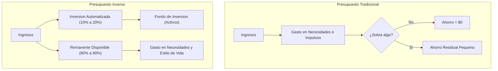
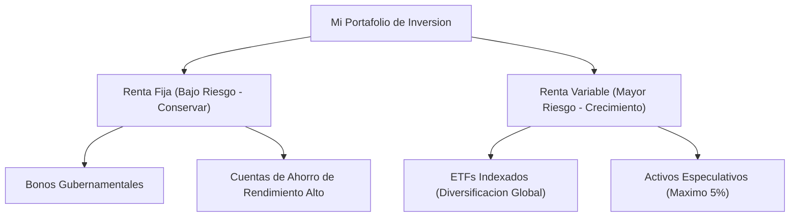

# Módulo 3: Finanzas Prácticas e Ingeniería de Hábitos de Riqueza

**Tiempo estimado**: 480 minutos (8 horas)  
**Nivel**: Intermedio (Ruta principal)  
**Fase**: Fase 3 — Estructuración de Sistemas de Acumulación  
**Prerrequisitos**: Módulos 0, 1 y 2 completados

---

## 1. Tema 3.1: Págate a ti Mismo Primero (Presupuesto Inverso)

La mayoría de las personas gestionan sus finanzas personales utilizando una fórmula destinada al fracaso:

$$\text{Ahorro} = \text{Ingresos} - \text{Gastos}$$

En este esquema, el ahorro es un residuo. Se ahorra lo que sobra al final del mes. Dado que el cerebro humano tiende a adaptar el nivel de consumo al dinero disponible (esto se llama **Ley de Parkinson**: "los gastos aumentan hasta cubrir los ingresos"), al final del mes el residuo suele ser cero.

Los verdaderos millonarios utilizan la fórmula del **Presupuesto Inverso**:

$$\text{Dinero disponible para gastar} = \text{Ingresos} - \text{Inversión/Ahorro Automatizado}$$

### Subtema 3.1.1: Automatización del Ahorro e Inversión

La fuerza de voluntad es un recurso limitado y poco fiable. No confíes en tu fuerza de voluntad para ahorrar. La clave está en la **automatización**:

1. Define un porcentaje inicial realista (mínimo el 10% de tus ingresos netos).
2. Configura transferencias automáticas en la aplicación de tu banco para que, el mismo día que recibes tu salario o ingresos, ese 10% sea transferido inmediatamente a una cuenta de inversión separada (por ejemplo, a una cuenta de corretaje o un fondo indexado).
3. Aprende a vivir y ajustar tus gastos al 90% restante. Al no ver ese dinero en tu cuenta corriente habitual, tu cerebro lo asume como inexistente y adapta el estilo de vida de forma natural.

### Subtema 3.1.2: Eliminación Sistemática de Gastos Hormiga

Los **gastos hormiga** son pequeños consumos diarios que parecen insignificantes de forma aislada, pero que tienen un impacto acumulativo devastador a mediano y largo plazo.

- _Ejemplo_: Un café de $3 pesos y un snack de $2 pesos comprados a diario fuera de casa suman $5 pesos al día, lo que equivale a $150 pesos al mes o $1,800 pesos al año.
- Si esos $150 pesos al mes se invirtieran a una tasa de retorno del 8% anual con interés compuesto, al cabo de 20 años se transformarían en **~$88,000 pesos**.
  Eliminar gastos hormiga no es un acto de privación extrema, es una reasignación inteligente de tu capital desde placeres instantáneos de baja densidad hacia tu libertad futura.

---

## 2. Tema 3.2: Inversión y Gestión de Riesgo

Una vez que has automatizado tu ahorro, el siguiente paso es poner ese dinero a trabajar de forma segura y eficiente. Ahorrar sin invertir es perder dinero por la inflación (como vimos en el Módulo 0).

### Subtema 3.2.1: Renta Fija vs. Renta Variable para Novatos

Para estructurar un portafolio de inversión básico, debes entender las dos grandes categorías de activos financieros:

| Característica | Renta Fija (Bonos, CDT, Tesoro)                                                             | Renta Variable (Acciones, Índices, ETFs)                                                 |
| :------------- | :------------------------------------------------------------------------------------------ | :--------------------------------------------------------------------------------------- |
| **Definición** | Prestas dinero a un gobierno o entidad a cambio de una tasa de interés fija predeterminada. | Compras una fracción de una empresa; tu ganancia depende de su crecimiento y dividendos. |
| **Riesgo**     | Muy bajo (si es deuda soberana de países estables).                                         | Moderado a alto (las acciones fluctúan a diario).                                        |
| **Retorno**    | Limitado y predecible.                                                                      | Potencialmente alto a largo plazo, pero variable.                                        |
| **Objetivo**   | Conservación del capital y liquidez.                                                        | Crecimiento del capital a largo plazo.                                                   |

Para principiantes, la estrategia más recomendada por premios Nobel de economía es la inversión pasiva a través de **Fondos Indexados (ETFs)** que replican índices diversificados de todo el mundo (como el S&P 500, que agrupa a las 500 empresas más grandes de EE.UU., o el MSCI World). Al comprar un solo fondo indexado, compras una pequeña porción de cientos de empresas a la vez, minimizando el riesgo de quiebra individual.

### Subtema 3.2.2: Diversificación y el Peligro del Dinero Rápido (Evitar FOMO)

El principal enemigo del inversor novato es el **FOMO (Fear of Missing Out)** o miedo a perderse algo. Es la emoción que te empuja a comprar criptomonedas especulativas, entrar a esquemas multinivel arriesgados o participar en "inversiones seguras del 20% mensual" porque viste a alguien en redes sociales presumir de ganancias rápidas.

- **La diversificación es tu único escudo real**: Nunca pongas más del 5% de tu capital en un solo activo individual de alto riesgo.
- Las ganancias rápidas suelen venir acompañadas de riesgos de pérdida total. La riqueza real se construye de forma aburrida, constante y sistemática.

---

## 3. Tema 3.3: Hábitos Diarios de Densidad Financiera

La arquitectura de tu riqueza está hecha de micro-decisiones diarias.

### Subtema 3.3.1: Rutinas Matutinas de Planificación

Los constructores de riqueza no improvisan su día. Dedican los primeros 10-15 minutos de la mañana a revisar sus prioridades estratégicas, lo que incluye:

- Revisar que sus gastos del día anterior coincidan con su presupuesto planificado.
- Enfocar su energía en la actividad de mayor retorno temporal del día (identificada en su plan de Skill Stacking del Módulo 2).

### Subtema 3.3.2: La Regla de las 24 Horas

Para neutralizar la compra por impulso emocional, aplica esta regla estricta:
Cuando sientas el deseo de comprar algo no esencial que supere el 10% de tu presupuesto semanal disponible:

1. **Espera 24 horas antes de pagar**.
2. Durante ese tiempo, la oleada de dopamina inicial (que te empuja a comprar por emoción) se disipará.
3. Al día siguiente, evalúa con tu corteza prefrontal activa si el objeto sigue pareciendo tan necesario o si prefieres destinar ese dinero a tu cuenta de inversión automatizada.
