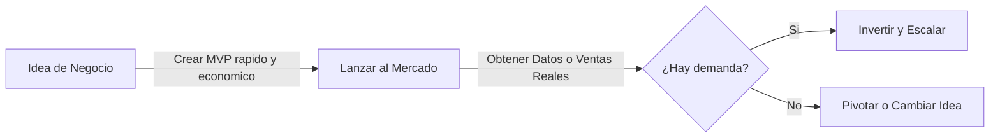

# Módulo 4: Ejecución, Resiliencia y Superación de Obstáculos

**Tiempo estimado**: 480 minutos (8 horas)  
**Nivel**: Intermedio (Ruta principal)  
**Fase**: Fase 4 — Ejecución de Tracción Rápida  
**Prerrequisitos**: Módulos 0, 1, 2 y 3 completados

---

## 1. Tema 4.1: Acción Imperfecta y Velocidad de Implementación

Muchas personas nunca inician sus proyectos financieros o de negocio porque esperan el "momento ideal" o creen que necesitan una planificación perfecta. Esto es un autoengaño cognitivo para evitar el miedo al fracaso. La realidad es que el mercado premia la **velocidad de implementación** y la **acción imperfecta**.

### Subtema 4.1.1: Parálisis por Análisis vs. Ejecución Ágil

La **parálisis por análisis** ocurre cuando dedicas tanto tiempo a sobreanalizar situaciones, buscar información adicional, prever problemas hipotéticos y planificar, que terminas agotando tu energía y perdiendo la oportunidad de actuar.

- En el desarrollo de productos modernos se aplica el principio de **ejecución ágil**: es mejor lanzar una versión imperfecta hoy y corregirla basándose en datos reales del mercado, que esperar a tener un producto perfecto que nadie quiere comprar.
- La perfección es enemiga de la ejecución. La información más valiosa solo se obtiene cuando interactúas de forma real con clientes y el mercado.

### Subtema 4.1.2: Validación Rápida de Ideas (MVP Personal)

El **Producto Mínimo Viable (MVP)** es la versión más simplificada y económica de tu idea que te permite probar si hay demanda real de clientes que estén dispuestos a pagar por ella.

- _Ejemplo_: Si quieres abrir una repostería, no alquiles un local ni compres maquinaria costosa (riesgo alto de pérdida). En su lugar, hornea 20 pasteles en tu cocina el fin de semana, crea una página de Instagram básica y ofrécelos a tus conocidos. Si logras venderlos y recibir pedidos adicionales, habrás validado la demanda con costo casi cero.

---

## 2. Tema 4.2: La Neurociencia del Fracaso y la Resiliencia

El camino hacia la riqueza está plagado de fallos, rechazos y errores. La resiliencia no es optimismo ciego; es una capacidad cognitiva que se puede entrenar.

### Subtema 4.2.1: Desensibilización al Rechazo

El cerebro humano procesa el rechazo social utilizando las mismas redes neuronales que procesan el **dolor físico** (la corteza cingulada anterior). Por eso, el miedo al rechazo ("no" del cliente, crítica de los pares) se siente biológicamente doloroso.

- Para mitigar este dolor, aplicamos la **desensibilización sistemática** o "terapia del rechazo" (popularizada por Jia Jiang). Consiste en exponerte voluntariamente a situaciones inofensivas de rechazo seguro para acostumbrar a tu amígdala a que el rechazo no representa una amenaza real de muerte. Al cabo de unos días de práctica, la respuesta de pánico se extingue.

### Subtema 4.2.2: Reencuadre Cognitivo del Fracaso como Feedback

El fracaso no define quién eres; define el resultado de una acción bajo ciertas variables. Los millonarios reencuadran el fracaso aplicando el método científico:

- Un experimento fallido en un laboratorio no hace llorar al científico; le da **datos valiosos** sobre lo que no funciona.
- Si una campaña de ventas fracasa, no significa "soy malo para las ventas"; significa: "esta propuesta de valor o este canal de distribución no resonó con esta audiencia específica bajo estas condiciones". Ajusta las variables y realiza el siguiente experimento.

---

## 3. Tema 4.3: Mitigación de Pérdidas y Pivotaje

Asumir riesgos no es equivalente a ser un apostador imprudente. Los millonarios son expertos en gestionar y mitigar la ruina.

### Subtema 4.3.1: Saber Cuándo Retirarse y Cuándo Duplicar

Existe un sesgo cognitivo llamado **sesgo del costo hundido**: la tendencia a continuar invirtiendo tiempo o dinero en un proyecto perdedor simplemente porque "ya he invertido mucho en él".

- Debes definir **límites de pérdidas** claros antes de iniciar cualquier proyecto (ej. "no invertir más de $500 pesos ni más de 3 meses sin obtener la primera venta"). Si se supera ese límite sin tracción real, lo más inteligente es cortar pérdidas, aprender de los datos y pivotar (cambiar la estrategia o el enfoque) hacia una alternativa más viable.

### Subtema 4.3.2: Construcción de un Colchón de Seguridad Anti-Ruina

Nunca arriesgues el dinero que necesitas para cubrir tus costos de vida básicos. La tranquilidad psicológica de tener un **Fondo de Emergencia** (equivalente a 3 a 6 meses de tus gastos fijos mensuales) depositado en un activo líquido de renta fija es lo que te permite tomar riesgos calculados en tus proyectos productivos. Sin este colchón, la visión de túnel del miedo bloqueará tu capacidad de innovación y toma de decisiones a largo plazo.
