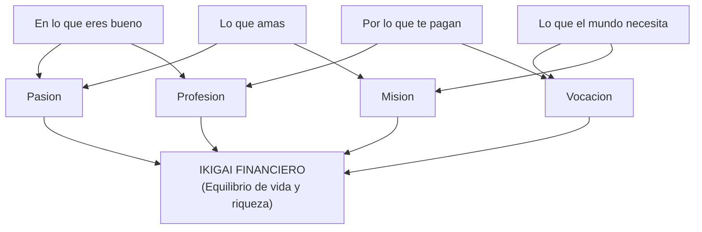
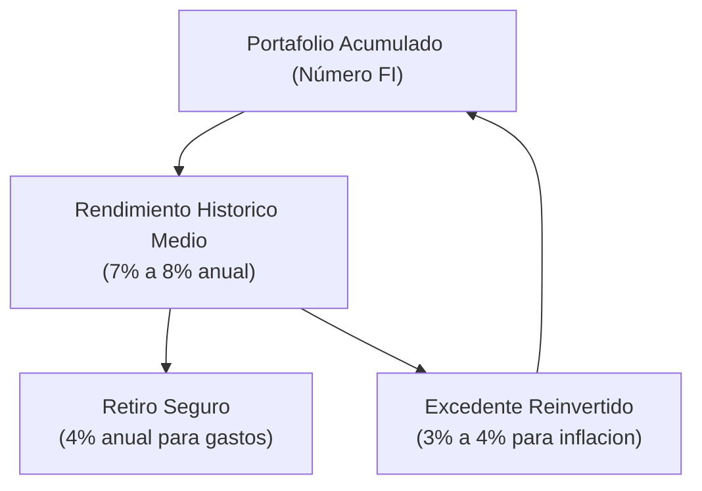

# Módulo 5: Propósito, Libertad Financiera y Legado

**Tiempo estimado**: 420 minutos (7 horas)  
**Nivel**: Intermedio-Avanzado (Ruta principal)  
**Fase**: Fase 5 — Integración de Vida y Trascendencia  
**Prerrequisitos**: Módulos 0, 1, 2, 3 y 4 completados

---

## 1. Tema 5.1: El Propósito como Motor

El dinero es un combustible extraordinario, pero es un pésimo propósito de vida. Quienes se enfocan únicamente en "ganar dinero" suelen cansarse rápidamente ante las primeras dificultades o, si lo consiguen, experimentan un vacío emocional profundo. Para construir riqueza sostenible, debes vincular tu actividad con un **propósito real de generación de valor**.

### Subtema 5.1.1: El Ikigai Financiero y el Valor Genuino

El **Ikigai** es un concepto japonés que significa "la razón de ser" o "la razón para levantarse por la mañana". Se representa como la intersección de cuatro grandes áreas de tu vida:

En las finanzas personales, buscamos el **Ikigai Financiero**:

- No basta con hacer lo que amas si el mercado no está dispuesto a pagar por ello.
- No basta con hacer algo bien pagado si odias realizarlo a diario (lo que conduce al agotamiento o _burnout_ y a gastar tu dinero en pasivos de escape emocional).
- El equilibrio consiste en encontrar una habilidad atómica que ames y en la que seas bueno, y que a la vez satisfaga una necesidad real del mercado por la que estén dispuestos a pagarte de forma recurrente.

### Subtema 5.1.2: El Dinero Persigue al Valor

Esta es la ley física del dinero: **el dinero es el eco del valor generado**.

- Si intentas "perseguir el dinero" directamente (mediante atajos o trucos rápidos), el dinero se alejará de ti.
- Si te enfocas en **resolver problemas reales** y aportar valor de forma masiva a otras personas (creando un producto útil, optimizando un servicio, facilitando la vida de los demás), el dinero llegará a ti como una consecuencia natural e inevitable.

---

## 2. Tema 5.2: Libertad Financiera Sostenible

La libertad financiera no consiste en tener carros de lujo o yates; consiste en **recuperar la propiedad sobre tu tiempo**. Es el punto en el que los ingresos pasivos de tus activos cubren la totalidad de tus gastos de vida.

### Subtema 5.2.1: Libertad vs. Riqueza Ostentosa

- **Riqueza Ostentosa**: Consiste en tener altos ingresos y gastarlos de inmediato en pasivos caros para mostrar estatus a los demás. Requiere trabajar constantemente para mantener el estilo de vida. Eres esclavo del flujo de ingresos.
- **Libertad Financiera**: Consiste en vivir por debajo de tus posibilidades y acumular activos. Si tus gastos mensuales son de $1,500 pesos y tus activos (fondos indexados, propiedades en alquiler) generan $1,600 pesos de forma pasiva, eres financieramente libre, independientemente de tu saldo total. Ya no necesitas trabajar por dinero.

### Subtema 5.2.2: Plan de Retiro y la Regla del 4%

La **regla del 4%** (derivada del célebre _Estudio Trinity_ de 1998) es el estándar matemático utilizado para calcular tu número de retiro. Establece que puedes retirar de forma segura el 4% anual de tu portafolio de inversión (ajustado por inflación) durante al menos 30 años sin riesgo de que el dinero se agote.

Para calcular tu **Número de Libertad Financiera (Número FI)**, aplica la siguiente fórmula:

$$\text{Número FI} = \text{Gastos Anuales} \times 25$$

#### Caso Práctico

Supongamos que tus gastos anuales para vivir cómodamente son de $18,000 pesos ($1,500 pesos al mes):

- Tu Número FI es: $18,000 \times 25 =$ **$450,000 pesos**.
- Si acumulas $450,000 pesos en un portafolio indexado diversificado (como el MSCI World), puedes retirar el 4% anual ($18,000 pesos, o $1,500 pesos al mes) indefinidamente, ajustando el retiro por inflación cada año, sin que tu capital principal se destruya en escenarios históricos normales de mercado.

---

## 3. Tema 5.3: Construcción de Legado y Filantropía

La acumulación de riqueza personal es solo la primera etapa del éxito financiero. La verdadera trascendencia se logra cuando tu riqueza sirve para impactar positivamente al mundo que te rodea.

### Subtema 5.3.1: Sistemas y Empresas que Trascienden

Los millonarios más influyentes dedican la última etapa de sus vidas a construir sistemas independientes de su presencia física que resuelven problemas sociales de gran escala (como fundaciones, fideicomisos educativos, o empresas con propósito social integrado).

- Crear empleo digno y desarrollar infraestructura productiva útil en tu comunidad es una de las formas de filantropía más poderosas y sostenibles que existen.

### Subtema 5.3.2: Devolución de Valor a la Comunidad

La riqueza real incluye la gratitud y la generosidad. Contribuir al desarrollo de otros (mediante mentorías gratuitas, donaciones a causas verificadas de educación o salud, o financiamiento de proyectos locales) no solo mejora la sociedad, sino que reprograma tu cerebro eliminando el miedo a la escasez. Dar es la confirmación definitiva de que tu mente opera bajo un marco de abundancia real.
