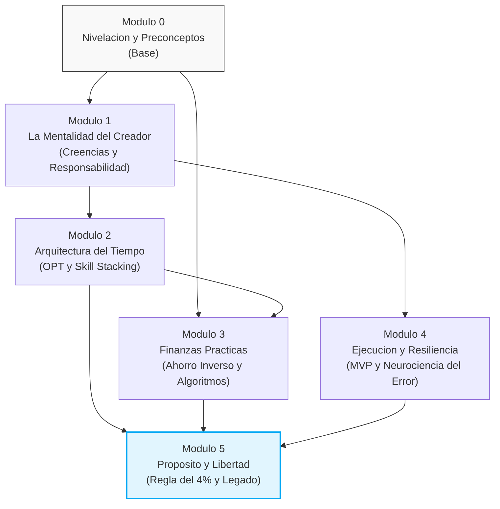

# PLAN CURRICULAR: MINDSET MILLONARIO

## Filosofía y prácticas de éxito de los verdaderos millonarios

---

## METADATA

| Campo                        | Valor                                                                                                           |
| ---------------------------- | --------------------------------------------------------------------------------------------------------------- |
| Codigo de curso              | TLAOZ-001                                                                                                       |
| Version                      | 1.0                                                                                                             |
| Fecha de creacion            | 2026-07-27                                                                                                      |
| Nivel de complejidad         | Baja-Media                                                                                                      |
| Duracion estimada            | 40 horas de estudio efectivo                                                                                    |
| Modalidad                    | Autoguiado con estructura modular                                                                               |
| Audiencia objetivo           | Personas del común que quieren superarse y desarrollar inteligencia financiera básica                           |
| Prerrequisitos formales      | Primaria completa                                                                                               |
| Prerrequisitos actitudinales | Apertura a examinar y cambiar hábitos de consumo y de pensamiento; disciplina para la práctica                  |
| Marco pedagogico             | Taxonomía de Bloom (desarrollo cognitivo y de comportamiento); Carga cognitiva controlada y práctica deliberada |

---

## MAPA CONCEPTUAL DE DEPENDENCIAS



---

## OBJETIVOS GENERALES DEL CURSO

Al completar este curso, el estudiante será capaz de:

1. **Identificar** y reformular creencias limitantes y patrones conductuales automáticos respecto al dinero y la riqueza en su vida cotidiana.
2. **Aplicar** el análisis de activos, pasivos e interés compuesto en un balance financiero personal simplificado y automatizado.
3. **Calcular** el costo de oportunidad de sus decisiones temporales y construir una estrategia de acumulación de habilidades (skill stacking).
4. **Diseñar** un plan de acción masiva imperfecta mediante un Producto Mínimo Viable (MVP) personal para validar ideas de generación de valor.
5. **Establecer** su número de Libertad Financiera utilizando la regla del 4% y estructurar un propósito de vida sostenible.

---

## ESTRUCTURA MODULAR DETALLADA

### MODULO 0 — Diagnóstico y Nivelación (Preconceptos)

**Duración estimada:** 3 horas
**Objetivo del módulo:** Homogeneizar los conceptos básicos de economía personal y calibrar la mentalidad inicial frente a la escasez y la abundancia.

- **Tema 0.1: La naturaleza del dinero**
  - _Objetivo Bloom:_ Recordar la función del dinero como medio de cambio y valor.
  - _Subtema 0.1.1:_ Conceptos de deuda y valor.
- **Tema 0.2: Mentalidad de Abundancia vs. Escasez**
  - _Objetivo Bloom:_ Comprender las diferencias cognitivas y fisiológicas de percibir el mundo desde la escasez.
  - _Subtema 0.2.1:_ Neurociencia de la escasez.
- **Tema 0.3: Activos y Pasivos**
  - _Objetivo Bloom:_ Distinguir con precisión qué es un activo y qué es un pasivo según el impacto en el flujo de caja.
  - _Subtema 0.3.1:_ El balance personal simple.
- **Tema 0.4: Interés Compuesto e Inflación**
  - _Objetivo Bloom:_ Comprender cómo el interés compuesto multiplica el capital a largo plazo y cómo la inflación lo erosiona.
  - _Subtema 0.4.1:_ La fórmula de la bola de nieve.
- **Tema 0.5: Empleo vs. Emprendimiento**
  - _Objetivo Bloom:_ Comparar los límites de ingresos y la gestión del tiempo en el autoempleo y el emprendimiento.
  - _Subtema 0.5.1:_ El cuadrante del flujo de dinero simplificado.

**Rutas:**

- _Ruta Básica:_ Temas 0.2 y 0.3 con lecturas cortas y analogías cotidianas.
- _Ruta Intermedia:_ Temas 0.1, 0.2, 0.3 y 0.4 con ejercicios simples de cálculo del balance.
- _Ruta Avanzada:_ Todos los temas más un ejercicio de proyección matemática de interés compuesto vs inflación a 10 años.

---

### MODULO 1 — La Mentalidad del Creador de Riqueza

**Duración estimada:** 7 horas
**Objetivo del módulo:** Desprogramar creencias financieras limitantes heredadas y asumir un rol activo y de responsabilidad radical sobre las finanzas personales.

- **Tema 1.1: Reconfiguración de Creencias Limitantes**
  - _Objetivo Bloom:_ Analizar patrones de pensamiento inconscientes heredados sobre el dinero y la riqueza.
  - _Subtema 1.1.1:_ Patrones heredados y termostato financiero.
  - _Subtema 1.1.2:_ Reprogramación del miedo a la pérdida.
- **Tema 1.2: Responsabilidad Radical**
  - _Objetivo Bloom:_ Evaluar el rol personal en los resultados financieros actuales, desplazando culpas externas.
  - _Subtema 1.2.1:_ De víctima a protagonista (Locus de Control interno).
  - _Subtema 1.2.2:_ Ownership en las decisiones financieras.
- **Tema 1.3: Visión Sistémica del Éxito**
  - _Objetivo Bloom:_ Aplicar mechanisms de gratificación diferida para construir riqueza a largo plazo.
  - _Subtema 1.3.1:_ Metas antifrágiles y delay of gratification.
  - _Subtema 1.3.2:_ Costo cognitivo de las decisiones inmediatas.

**Rutas:**

- _Ruta Básica:_ Temas 1.1 y 1.2 con diarios de auto-observación de creencias.
- _Ruta Intermedia:_ Todos los temas con mapeo de locus de control financiero personal.
- _Ruta Avanzada:_ Todos los temas más lecturas del comportamiento sobre sesgos en decisiones financieras inmediatas.

---

### MODULO 2 — Arquitectura del Tiempo y Costo de Oportunidad

**Duración estimada:** 7 horas
**Objetivo del módulo:** Optimizar el uso del tiempo como recurso más valioso y estructurar un plan de desarrollo continuo de habilidades de alta demanda.

- **Tema 2.1: El Tiempo como Activo Finito**
  - _Objetivo Bloom:_ Calcular el valor real por hora de vida y comprender el concepto de apalancamiento temporal.
  - _Subtema 2.1.1:_ Cálculo de tasa real por hora.
  - _Subtema 2.1.2:_ Apalancamiento de tiempo de otros (OPT).
- **Tema 2.2: Interés Compuesto del Conocimiento**
  - _Objetivo Bloom:_ Diseñar un plan de adquisición de habilidades complementarias para incrementar el valor de mercado propio.
  - _Subtema 2.2.1:_ Curvas de aprendizaje y hábitos atómicos.
  - _Subtema 2.2.2:_ Skill stacking e ingresos alternativos.
- **Tema 2.3: Análisis de Costo de Oportunidad**
  - _Objetivo Bloom:_ Evaluar decisiones financieras y personales analizando la alternativa no elegida.
  - _Subtema 2.3.1:_ Decisiones bajo incertidumbre.
  - _Subtema 2.3.2:_ Costo invisible de la procrastinación.

**Rutas:**

- _Ruta Básica:_ Temas 2.1 y 2.2 enfocados en auditoría simple del tiempo diario.
- _Ruta Intermedia:_ Todos los temas con plan de skill stacking básico de 3 habilidades.
- _Ruta Avanzada:_ Todos los temas con cálculo riguroso del retorno de inversión temporal en actividades personales.

---

### MODULO 3 — Finanzas Prácticas e Ingeniería de Hábitos de Riqueza

**Duración estimada:** 8 horas
**Objetivo del módulo:** Implementar sistemas sencillos y automatizados de presupuesto, ahorro e inversión controlando sesgos emocionales.

- **Tema 3.1: Págate a ti Mismo Primero**
  - _Objetivo Bloom:_ Crear un sistema de ahorro e inversión inverso automatizado.
  - _Subtema 3.1.1:_ Automatización del ahorro e inversión.
  - _Subtema 3.1.2:_ Eliminación sistemática de gastos hormiga.
- **Tema 3.2: Inversión y Gestión de Riesgo**
  - _Objetivo Bloom:_ Evaluar alternativas simples de inversión minimizando el riesgo de pérdida total.
  - _Subtema 3.2.1:_ Renta fija vs. variable para novatos.
  - _Subtema 3.2.2:_ Diversificación y peligro del dinero rápido (evitar FOMO).
- **Tema 3.3: Hábitos Diarios de Densidad Financiera**
  - _Objetivo Bloom:_ Implementar micro-comportamientos diarios de control financiero y contención cognitiva.
  - _Subtema 3.3.1:_ Rutinas matutinas de planificación.
  - _Subtema 3.3.2:_ La regla de las 24 horas.

**Rutas:**

- _Ruta Básica:_ Temas 3.1 y 3.3 con plantillas de ahorro fijo del 10%.
- _Ruta Intermedia:_ Todos los temas con diseño de portafolio de inversión básico (renta fija e índices indexados).
- _Ruta Avanzada:_ Todos los temas más simulaciones de escenarios históricos de caída bursátil y planes de contingencia.

---

### MODULO 4 — Ejecución, Resiliencia y Superación de Obstáculos

**Duración estimada:** 8 horas
**Objetivo del módulo:** Acelerar el paso de la teoría a la práctica y desarrollar tolerancia neurológica frente al fracaso y el error en iniciativas productivas.

- **Tema 4.1: Acción Imperfecta y Velocidad de Implementación**
  - _Objetivo Bloom:_ Aplicar la metodología de Producto Mínimo Viable para probar ideas comerciales rápidamente sin arriesgar capital excesivo.
  - _Subtema 4.1.1:_ Parálisis por análisis vs. ejecución ágil.
  - _Subtema 4.1.2:_ Validación rápida de ideas y MVP personal.
- **Tema 4.2: La Neurociencia del Fracaso**
  - _Objetivo Bloom:_ Comprender y condicionar el cerebro para responder al error como retroalimentación informativa y no identitaria.
  - _Subtema 4.2.1:_ Desensibilización al rechazo.
  - _Subtema 4.2.2:_ Reencuadre cognitivo del fracaso como feedback.
- **Tema 4.3: Mitigación de Pérdidas y Pivotaje**
  - _Objetivo Bloom:_ Evaluar proyectos activos con base en datos reales para saber cuándo reestructurar, pausar o potenciar la iniciativa.
  - _Subtema 4.3.1:_ Saber cuándo retirarse y cuándo duplicar.
  - _Subtema 4.3.2:_ Construcción de colchón de seguridad anti-ruina.

**Rutas:**

- _Ruta Básica:_ Temas 4.1 y 4.2 con enfoque en ejercicios de desensibilización al rechazo simple.
- _Ruta Intermedia:_ Todos los temas con el diseño de un MVP de baja complejidad y costo cero.
- _Ruta Avanzada:_ Todos los temas con la ejecución y análisis de métricas de tracción de una idea de negocio viable.

---

### MODULO 5 — Propósito, Libertad Financiera y Legado

**Duración estimada:** 7 horas
**Objetivo del módulo:** Integrar la generación de dinero en una vida rica en propósito y trazar la ruta de retiro o independencia definitiva con un legado social estructurado.

- **Tema 5.1: El Propósito como Motor**
  - _Objetivo Bloom:_ Analizar el concepto de Ikigai aplicado al entorno financiero propio.
  - _Subtema 5.1.1:_ Ikigai financiero y valor genuino.
  - _Subtema 5.1.2:_ El dinero persigue al valor.
- **Tema 5.2: Libertad Financiera Sostenible**
  - _Objetivo Bloom:_ Aplicar la regla matemática del 4% para definir objetivos concretos de capital acumulado.
  - _Subtema 5.2.1:_ Libertad vs. riqueza ostentosa.
  - _Subtema 5.2.2:_ Plan de retiro anticipado y regla del 4%.
- **Tema 5.3: Construcción de Legado**
  - _Objetivo Bloom:_ Diseñar sistemas duraderos para mentorizar o retribuir valor social en su comunidad.
  - _Subtema 5.3.1:_ Sistemas y empresas que trascienden.
  - _Subtema 5.3.2:_ Devolución de valor a la comunidad.

---

## ## ARBOL CURRICULAR (JSON)

```json
[
  {
    "modulo_id": "0",
    "titulo": "Diagnóstico y Nivelación (Preconceptos)",
    "fase": "Fase 0 — Nivelación de Entrada",
    "duracion_estimada_min": 180,
    "temas": [
      {
        "tema_id": "0.1",
        "titulo": "La naturaleza del dinero",
        "subtemas": [
          {
            "subtema_id": "0.1.1",
            "titulo": "Conceptos de deuda y valor"
          }
        ]
      },
      {
        "tema_id": "0.2",
        "titulo": "Mentalidad de Abundancia vs. Escasez",
        "subtemas": [
          {
            "subtema_id": "0.2.1",
            "titulo": "Neurociencia de la escasez"
          }
        ]
      },
      {
        "tema_id": "0.3",
        "titulo": "Activos y Pasivos",
        "subtemas": [
          {
            "subtema_id": "0.3.1",
            "titulo": "El balance personal simple"
          }
        ]
      },
      {
        "tema_id": "0.4",
        "titulo": "Interés Compuesto e Inflación",
        "subtemas": [
          {
            "subtema_id": "0.4.1",
            "titulo": "La fórmula de la bola de nieve"
          }
        ]
      },
      {
        "tema_id": "0.5",
        "titulo": "Empleo vs. Emprendimiento",
        "subtemas": [
          {
            "subtema_id": "0.5.1",
            "titulo": "El cuadrante del flujo de dinero simplificado"
          }
        ]
      }
    ]
  },
  {
    "modulo_id": "1",
    "titulo": "La Mentalidad del Creador de Riqueza",
    "fase": "Fase 1 — Desconstrucción del Mindset Limitado",
    "duracion_estimada_min": 420,
    "temas": [
      {
        "tema_id": "1.1",
        "titulo": "Reconfiguración de Creencias Limitantes",
        "subtemas": [
          {
            "subtema_id": "1.1.1",
            "titulo": "Patrones heredados y termostato financiero"
          },
          {
            "subtema_id": "1.1.2",
            "titulo": "Reprogramación del miedo a la pérdida"
          }
        ]
      },
      {
        "tema_id": "1.2",
        "titulo": "Responsabilidad Radical",
        "subtemas": [
          {
            "subtema_id": "1.2.1",
            "titulo": "De víctima a protagonista (Locus de Control interno)"
          },
          {
            "subtema_id": "1.2.2",
            "titulo": "Ownership en las decisiones financieras"
          }
        ]
      },
      {
        "tema_id": "1.3",
        "titulo": "Visión Sistémica del Éxito",
        "subtemas": [
          {
            "subtema_id": "1.3.1",
            "titulo": "Metas antifrágiles y delay of gratification"
          },
          {
            "subtema_id": "1.3.2",
            "titulo": "Costo cognitivo de las decisiones inmediatas"
          }
        ]
      }
    ]
  },
  {
    "modulo_id": "2",
    "titulo": "Arquitectura del Tiempo y Costo de Oportunidad",
    "fase": "Fase 2 — Optimización de Activos Intangibles",
    "duracion_estimada_min": 420,
    "temas": [
      {
        "tema_id": "2.1",
        "titulo": "El Tiempo como Activo Finito",
        "subtemas": [
          {
            "subtema_id": "2.1.1",
            "titulo": "Cálculo de tasa real por hora"
          },
          {
            "subtema_id": "2.1.2",
            "titulo": "Apalancamiento de tiempo de otros (OPT)"
          }
        ]
      },
      {
        "tema_id": "2.2",
        "titulo": "Interés Compuesto del Conocimiento",
        "subtemas": [
          {
            "subtema_id": "2.2.1",
            "titulo": "Curvas de aprendizaje y hábitos atómicos"
          },
          {
            "subtema_id": "2.2.2",
            "titulo": "Skill stacking e ingresos alternativos"
          }
        ]
      },
      {
        "tema_id": "2.3",
        "titulo": "Análisis de Costo de Oportunidad",
        "subtemas": [
          {
            "subtema_id": "2.3.1",
            "titulo": "Decisiones bajo incertidumbre"
          },
          {
            "subtema_id": "2.3.2",
            "titulo": "Costo invisible de la procrastinación"
          }
        ]
      }
    ]
  },
  {
    "modulo_id": "3",
    "titulo": "Finanzas Prácticas e Ingeniería de Hábitos de Riqueza",
    "fase": "Fase 3 — Estructuración de Sistemas de Acumulación",
    "duracion_estimada_min": 480,
    "temas": [
      {
        "tema_id": "3.1",
        "titulo": "Págate a ti Mismo Primero",
        "subtemas": [
          {
            "subtema_id": "3.1.1",
            "titulo": "Automatización del ahorro e inversión"
          },
          {
            "subtema_id": "3.1.2",
            "titulo": "Eliminación sistemática de gastos hormiga"
          }
        ]
      },
      {
        "tema_id": "3.2",
        "titulo": "Inversión y Gestión de Riesgo",
        "subtemas": [
          {
            "subtema_id": "3.2.1",
            "titulo": "Renta fija vs. variable para novatos"
          },
          {
            "subtema_id": "3.2.2",
            "titulo": "Diversificación y peligro del dinero rápido (evitar FOMO)"
          }
        ]
      },
      {
        "tema_id": "3.3",
        "titulo": "Hábitos Diarios de Densidad Financiera",
        "subtemas": [
          {
            "subtema_id": "3.3.1",
            "titulo": "Rutinas matutinas de planificación"
          },
          {
            "subtema_id": "3.3.2",
            "titulo": "La regla de las 24 horas"
          }
        ]
      }
    ]
  },
  {
    "modulo_id": "4",
    "titulo": "Ejecución, Resiliencia y Superación de Obstáculos",
    "fase": "Fase 4 — Ejecución de Tracción Rápida",
    "duracion_estimada_min": 480,
    "temas": [
      {
        "tema_id": "4.1",
        "titulo": "Acción Imperfecta y Velocidad de Implementación",
        "subtemas": [
          {
            "subtema_id": "4.1.1",
            "titulo": "Parálisis por análisis vs. ejecución ágil"
          },
          {
            "subtema_id": "4.1.2",
            "titulo": "Validación rápida de ideas y MVP personal"
          }
        ]
      },
      {
        "tema_id": "4.2",
        "titulo": "La Neurociencia del Fracaso",
        "subtemas": [
          {
            "subtema_id": "4.2.1",
            "titulo": "Desensibilización al rechazo"
          },
          {
            "subtema_id": "4.2.2",
            "titulo": "Reencuadre cognitivo del fracaso como feedback"
          }
        ]
      },
      {
        "tema_id": "4.3",
        "titulo": "Mitigación de Pérdidas y Pivotaje",
        "subtemas": [
          {
            "subtema_id": "4.3.1",
            "titulo": "Saber cuándo retirarse y cuándo duplicar"
          },
          {
            "subtema_id": "4.3.2",
            "titulo": "Construcción de colchón de seguridad anti-ruina"
          }
        ]
      }
    ]
  },
  {
    "modulo_id": "5",
    "titulo": "Propósito, Libertad Financiera y Legado",
    "fase": "Fase 5 — Integration de Vida y Trascendencia",
    "duracion_estimada_min": 420,
    "temas": [
      {
        "tema_id": "5.1",
        "titulo": "El Propósito como Motor",
        "subtemas": [
          {
            "subtema_id": "5.1.1",
            "titulo": "Ikigai financiero y valor genuino"
          },
          {
            "subtema_id": "5.1.2",
            "titulo": "El dinero persigue al valor"
          }
        ]
      },
      {
        "tema_id": "5.2",
        "titulo": "Libertad Financiera Sostenible",
        "subtemas": [
          {
            "subtema_id": "5.2.1",
            "titulo": "Libertad vs. riqueza ostentosa"
          },
          {
            "subtema_id": "5.2.2",
            "titulo": "Plan de retiro anticipado y regla del 4%"
          }
        ]
      },
      {
        "tema_id": "5.3",
        "titulo": "Construcción de Legado",
        "subtemas": [
          {
            "subtema_id": "5.3.1",
            "titulo": "Sistemas y empresas que trascienden"
          },
          {
            "subtema_id": "5.3.2",
            "titulo": "Devolución de valor a la comunidad"
          }
        ]
      }
    ]
  }
]
```
